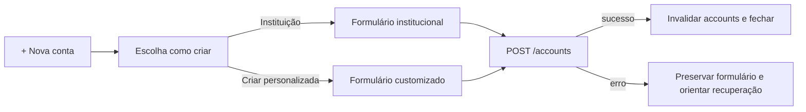

# Criar e atualizar conta por template

## Objetivo e entrada

O usuário autenticado gerencia accounts em `/accounts`. `+ Nova conta` abre um
sheet contextual; `Editar` abre diretamente o formulário da identidade vigente.
Todas as operações usam a sessão por cookies HttpOnly e nunca enviam `userId`.

## Fluxo de criação

Na etapa inicial, o catálogo ocupa a região rolável e a ação personalizada
permanece fora do scroll. Loading usa skeletons; lista vazia explica a ausência
sem bloquear a alternativa personalizada; erro oferece retry local.

Ao escolher instituição, o nome é preenchido com `template.name`, mas continua
editável. O request usa o branch `institutional`. No custom, o usuário escolhe
cor/ícone e o request usa o branch `custom`. Ambos criam somente `BANK` na V0 e
mantêm saldo inicial em centavos inteiros.

## Fluxo de atualização

- Institucional: nome, tipo informativo, saldo inicial somente leitura e
  `includeInTotal`; identidade institucional não é editável.
- Custom: nome, tipo informativo, saldo inicial somente leitura, cor, ícone e
  `includeInTotal`; alteração visual envia `template.type="custom"`.
- Legada sem `template`: usa `color`/`icon` para defaults e materializa custom
  no primeiro update visual.
- Patch sem diff permanece desabilitado; `initialBalanceCents` nunca entra no
  update.

## Detalhe e aprofundamento em transações

Abrir um card habilita, somente naquele momento, a consulta do resumo financeiro
da account para o mês selecionado em Accounts. O request não envia `type` e usa
`status=EFFECTIVE`; por isso uma única resposta overview alimenta receitas e
despesas. A paginação pede somente um item, mas o summary representa todos os
itens que atendem aos filtros.

Enquanto carrega, as duas células mantêm skeletons. Uma falha preserva nome,
saldo e demais dados da account e apresenta alerta inline com `Tentar
novamente`. O tooltip de cada célula explica que o valor é o total efetivado do
período selecionado.

- `Receitas` abre `/transactions` com `view=INCOME`, account, período e
  `status=EFFECTIVE`.
- `Despesas` abre `/transactions` com `view=EXPENSE`, account, período e
  `status=EFFECTIVE`.
- `Ver transações` abre a listagem com somente `accountId` explícito; o período
  é o default da tela de Transactions.

O grid apresenta nome/saldo inicial, receitas/despesas e, por fim, tipo/total
geral. Tendência de alta identifica entrada e tendência de baixa identifica
saída, sempre acompanhadas por rótulo e cor sem depender somente da cor.

## Estados e recuperação

- Pending desabilita submit e preserva dimensões/valores.
- `VALIDATION_ERROR` marca os campos conhecidos e foca o primeiro inválido.
- `ACCOUNT_TEMPLATE_NOT_FOUND` mantém os dados e orienta voltar/atualizar a
  escolha institucional.
- `INVALID_ACCOUNT_TEMPLATE` orienta escolher outra instituição, cor ou ícone.
- `ACCOUNT_TEMPLATE_INPUT_CONFLICT` usa alerta inline; o frontend novo não gera
  payload misto.
- `ACCOUNT_ARCHIVED`/`ACCOUNT_ARCHIVED_MUTATION` orienta restaurar a account.
- Rede, erro desconhecido e `500` mantêm o sheet e oferecem recuperação segura.
- Sessão inválida é delegada ao fluxo global de autenticação.

## Consumo backend

| Operação                 | Autenticação     | Contrato relevante                                                | Efeito/cache                                                     | Erros e recuperação                                                               | Fonte                                                          |
| ------------------------ | ---------------- | ----------------------------------------------------------------- | ---------------------------------------------------------------- | --------------------------------------------------------------------------------- | -------------------------------------------------------------- |
| `GET /account-templates` | Cookies HttpOnly | Lista somente institucionais ativos, com `logoUrl` e `colorToken` | Cache próprio de catálogo; não é invalidado por account mutation | Sessão global; network/`500` inline com retry                                     | Backend `docs/integrations/accounts/list-account-templates.md` |
| `POST /accounts`         | Cookies HttpOnly | `template` discriminado; `BANK`; saldo em centavos                | Invalida família `accounts` após `201`                           | Validation em campo; template inválido/ausente inline; rede/`500` preservam dados | Backend `docs/integrations/accounts/create-account.md`         |
| `PATCH /accounts/:id`    | Cookies HttpOnly | Não aceita saldo inicial; custom atualiza por `template`          | Invalida família `accounts` após `200`                           | Not found, archived, empty e template errors com recuperação contextual           | Backend `docs/integrations/accounts/update-account.md`         |
| `GET /accounts`          | Cookies HttpOnly | `template` primário; raiz visual deprecated como fallback         | Alimenta cards e consumers de transactions                       | Falha fica no painel da lista com retry                                           | Backend `docs/integrations/accounts/list-accounts.md`          |
| `GET /transactions`      | Cookies HttpOnly | Overview summary sem `type`; account + mês + `EFFECTIVE`           | Query lazy ao abrir detalhe; cache por filtros; `limit=1`         | Falha fica no detalhe com retry; sessão usa recuperação global                    | Backend `docs/integrations/transactions/list-transactions.md`  |

## Segurança, acessibilidade e movimento

O frontend não consulta fontes externas para descobrir instituições e não
expõe identificadores técnicos em copy. Opções têm nome acessível e touch target
estável; cor sempre acompanha logo/ícone e texto. Avançar move lista para a
esquerda e formulário para dentro pela direita; voltar inverte a direção. Com
`prefers-reduced-motion`, a troca não depende de deslocamento.
