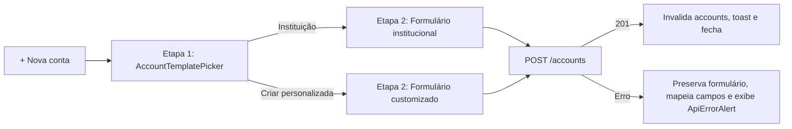

# Criar e Atualizar Conta por Template

Descreve o fluxo de criação em duas etapas (identidade → dados) e atualização de contas institucionais, personalizadas e legadas em `/accounts`.

## Atores, Pré-condições e Pontos de Entrada

- **Ator:** usuário autenticado com e-mail verificado.
- **Rota frontend:** `/accounts`.
- **Pontos de entrada:** `+ Nova conta` (`AddAccountButton`), `CreateAccountCard` (modo `create`), ou `Editar` no `AccountActionsMenu` / `Editar conta` no dialog desktop de detalhe (modo `edit`).

## Fluxo de Criação (`mode: 'create'`)

1. **Etapa 1 — Escolha de identidade (`AccountTemplatePicker`):**
   - `GET /account-templates` é habilitado apenas em modo `create` (`staleTime: 5 min`).
   - O catálogo institucional ocupa a área rolável; a opção `Criar personalizada` permanece fixa fora do scroll.
   - Loading usa 6 skeletons; lista vazia explica a ausência sem bloquear `Criar personalizada`; erro exibe `ApiErrorAlert` inline (`accounts.templates`) com retry.
2. **Etapa 2 — Formulário financeiro (`AccountFormSheet`):**
   - A transição desliza em `200ms` (desativada com `prefers-reduced-motion`) e move foco programático para o título da etapa.
   - **Institucional:** pré-preenche `name` com `template.name` (editável) e envia `template: { type: 'institutional', templateId }`.
   - **Personalizada:** exibe `CustomAccountIdentityFields` (5 cores inline + overflow `Outras cores`; 5 ícones inline + overflow `Outros ícones`) e envia `template: { type: 'custom', colorToken, iconKey }`.
   - Ambos criam com `type: 'BANK'` (informativo, não editável na V0), `isDefault: false` e `initialBalanceCents` opcional em centavos inteiros.
   - Clicar em `Voltar` limpa o erro de `createMutation` e retorna ao picker (ao selecionar novamente na etapa 1, o formulário reseta com os defaults da nova seleção).

## Fluxo de Atualização (`mode: 'edit'`)

- Abre diretamente na etapa de formulário sem etapa de picker.
- `initialBalanceCents` é exibido apenas para leitura e **nunca** é incluído em `PATCH /accounts/:id`.
- **Institucional:** permite editar `name` e `includeInTotal`; identidade institucional permanece somente leitura (não troca de instituição nem converte para personalizada).
- **Personalizada:** permite editar `name`, `includeInTotal` e identidade visual (`template: { type: 'custom', colorToken, iconKey }`).
- **Legada (`account.template === null`):** carrega defaults de `account.color`/`account.icon` (fallback `blue`/`wallet`) e materializa `template` customizado ao salvar.
- O envio é **diff-only** (`buildUpdateAccountDto`); o botão fica desabilitado se `!isDirty`, `!isValid` ou `isPending`.

## Estados de Interface e Recuperação

| Cenário / Código | Comportamento observado | Recuperação |
| --- | --- | --- |
| Pending | Botão submit desabilitado preservando valores e dimensões | Evita duplo envio |
| `VALIDATION_ERROR` | `applyApiFieldErrors` mapeia `name`, `initialBalanceCents`, `template.templateId`, `template.colorToken`, `template.iconKey`, `includeInTotal` e foca o primeiro campo inválido | Corrigir campo e reenviar |
| `ACCOUNT_TEMPLATE_NOT_FOUND` / `INVALID_ACCOUNT_TEMPLATE` | `ApiErrorAlert` inline preservando formulário | Voltar ao picker ou ajustar cor/ícone |
| `ACCOUNT_TEMPLATE_INPUT_CONFLICT` | `ApiErrorAlert` inline (UI atual não gera payload misto) | Reenviar / recarregar |
| `ACCOUNT_ARCHIVED` / `ACCOUNT_ARCHIVED_MUTATION` | `ApiErrorAlert` inline orientando restaurar a conta | Restaurar conta antes de editar |
| Rede / `500` / desconhecido | `ApiErrorAlert` seguro preservando todos os campos | Tentar novamente |

## Segurança e Acessibilidade

- Sessão via cookies HttpOnly; nenhum `userId` no payload.
- Nenhuma consulta externa para descoberta de instituições; `logoUrl` vem exclusivamente do backend.
- Cor sempre acompanhada de logo/ícone e rótulo textual; foco gerenciado entre etapas.

## Consumo de Backend

| Operação | Autenticação | Contrato relevante | Efeito / Cache | Erros e recuperação | Fonte |
| --- | --- | --- | --- | --- | --- |
| `GET /account-templates` | Cookie HttpOnly | Catálogo institucional ativo (`logoUrl`, `colorToken`, `iconKey`) | `['account-templates']` (`staleTime: 5m`; não invalidado por mutações de conta) | `ApiErrorAlert` inline (`accounts.templates`) + retry | `personal-finance-backend:docs/integrations/accounts/list-account-templates.md` |
| `POST /accounts` | Cookie HttpOnly | `CreateAccountDto` (`template` discriminado, `type: 'BANK'`, `initialBalanceCents?`) | Invalida `['accounts']` (`exact: false`) + toast | Field errors + `ApiErrorAlert` inline (`accounts.create`) | `personal-finance-backend:docs/integrations/accounts/create-account.md` |
| `PATCH /accounts/:id` | Cookie HttpOnly | `UpdateAccountDto` diff-only (sem `initialBalanceCents`) | Invalida `['accounts']` (`exact: false`) + toast | Field errors + `ApiErrorAlert` inline (`accounts.update`) | `personal-finance-backend:docs/integrations/accounts/update-account.md` |
