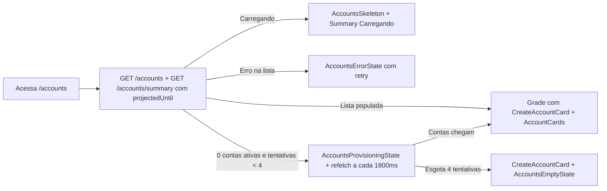

# Listagem, Provisionamento Inicial e Filtro de Período de Contas

Descreve a entrada em `/accounts`, o carregamento dos cards de resumo e contas, o tratamento de provisionamento da conta padrão e a alternância de período e contas arquivadas.

## Atores, Pré-condições e Pontos de Entrada

- **Ator:** usuário autenticado com e-mail verificado.
- **Rota frontend:** `/accounts` (`PrivateRoute`, título `Danfy Finance | Contas`), envolvida em `AuthAppShell` (`activeSection="accounts"`).
- **Estado de tela:** atualmente `selectedPeriod` (`YearMonth`) e `includeArchived` (`boolean`) vivem em `useState` local em `AccountsPage` (sem sincronização com a URL).

## Fluxo Principal e Alternativos

1. **Filtro de período (`MonthYearPicker` + setas):**
   - Permite avançar ou retroceder meses (`Mês anterior`, `MonthYearPicker`, `Próximo mês`), atualizando `projectedUntil` (`YYYY-MM-DD`, último dia do mês).
   - Atualiza dinamicamente os rótulos via `compareYearMonth(selectedPeriod)` (`past` vs. `current`/`future`).
2. **Resumo consolidado:**
   - Renderiza dois `AccountSummaryCard`s (`Saldo atual` e saldo projetado/fim do período) alimentados por `GET /accounts/summary`.
   - Em falha de resumo, mantém a grade de contas utilizável e mostra `ApiErrorAlert` inline (`accounts.summary`) com botão de retry.
3. **Provisionamento da conta inicial (`AccountsProvisioningState`):**
   - Quando `!includeArchived`, a lista retorna vazia e `defaultProvisionAttempts < 4`, exibe estado de provisionamento com `LoaderCircle` e dispara `refetch()` a cada `1800ms` (até 4 tentativas).
   - Ao chegar contas ou alternar `includeArchived`, o contador reseta.
4. **Mostrar contas arquivadas:**
   - Menu `⋮` no topo oferece checkbox `Mostrar contas arquivadas` (`DropdownMenuCheckboxItem`), destacando o gatilho quando ativo e refazendo `useAccounts({ includeArchived, projectedUntil })`.
   - Quando `includeArchived === false`, a página também filtra defensivamente `!account.isArchived`.

## Estados de Interface e Recuperação

| Estado | Comportamento observado | Recuperação / Próximo passo |
| --- | --- | --- |
| Loading lista | `AccountsSkeleton` (4 cards pulsantes); refetch exibe `Atualizando contas...` | Aguarda resolução |
| Loading resumo | Cards exibem `Carregando` (`isNumeric={false}`) | Aguarda resolução |
| Provisioning | `AccountsProvisioningState` com polling controlado (4× 1800ms) | Conclui automaticamente ou recua para empty state |
| Empty | `CreateAccountCard` + `AccountsEmptyState` | Criar nova conta |
| Error lista | `AccountsErrorState` (`ApiErrorAlert` `accounts.list`) | Botão `Tentar novamente` |
| Error resumo | Cards mostram `Não carregado` + `ApiErrorAlert` (`accounts.summary`) abaixo dos cards | Botão `Tentar novamente` |

## Consumo de Backend

| Operação | Autenticação | Contrato relevante | Efeito / Cache | Erros e recuperação | Fonte |
| --- | --- | --- | --- | --- | --- |
| `GET /accounts` | Cookie HttpOnly | Query `includeArchived`, `projectedUntil` (`DateOnly`) | `['accounts', { includeArchived, projectedUntil }]` (`staleTime: 30s`, `retry < 2`) | `ApiErrorAlert` inline (`accounts.list`) + retry | `personal-finance-backend:docs/integrations/accounts/list-accounts.md` |
| `GET /accounts/summary` | Cookie HttpOnly | Query `projectedUntil`, `includeArchived`, `includeExcludedFromTotal` | `['accounts', 'summary', params]` (`staleTime: 30s`, `retry < 2`) | `ApiErrorAlert` inline (`accounts.summary`) + retry | `personal-finance-backend:docs/integrations/accounts/get-account-summary.md` |
