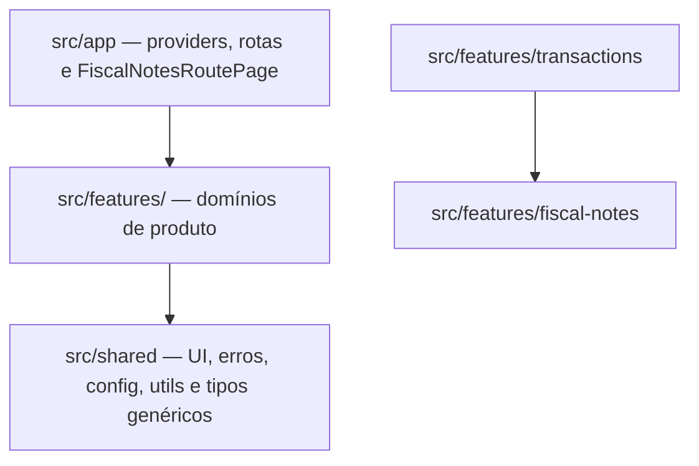

# Limites entre Módulos (Module Boundaries)

Este documento define as fronteiras, regras de dependência e dívidas técnicas registradas entre `src/app/`, `src/shared/` e os módulos de domínio em `src/features/` no frontend da Danfy.

## 1. Camadas e Direção de Dependência

1. **`src/app/`** compõe providers globais (`QueryProvider`), rotas (`src/app/routes/index.tsx`) e compositores finos de rota (como `src/app/pages/FiscalNotesRoutePage.tsx`). Pode importar páginas, layouts, seletores públicos e bootstrap de `src/features/*` e utilitários de `src/shared/`.
   - **Compositor fino `/fiscal-notes` (`src/app/pages/FiscalNotesRoutePage.tsx`):** conecta `FiscalNotesPage` e `FiscalNoteReaderSheet` (`@/features/fiscal-notes`) ao `AuthAppShell` (`auth`), contas (`accounts`), categorias (`categories`), seletores/staging de anexos via `@/features/transactions` e navegação `/transactions?openTransaction=<id>`, preservando a fronteira acíclica `app -> auth/accounts/categories/transactions/fiscal-notes`.
2. **`src/features/<modulo>/`** encapsula cada domínio do produto (`accounts`, `auth`, `categories`, `fiscal-notes`, `transactions`).
   - Cada módulo possui `api/`, `components/` (Atomic Design), `constants/`, `schemas/`, `types/`, `utils/` (e `stores/`/`hooks/` quando necessários) + seu `AGENTS.md` local.
   - Regras de negócio, queries, mutations, schemas e helpers internos devem permanecer privados ao módulo.
   - **Fronteira acíclica de `fiscal-notes`:** `app` e `transactions` consomem `fiscal-notes` exclusivamente via `@/features/fiscal-notes` (`src/features/fiscal-notes/index.ts`), enquanto `fiscal-notes` **não** importa nenhuma outra feature (`transactions`, `accounts`, `categories` ou `auth`). Extensões como staging de anexos, leitura inline em `/fiscal-notes` e abertura de despesa existente usam slots/callbacks (`onImportFiscalNote`, `onOpenTransaction`, `renderAttachmentsField`, `onAfterImport`, `onOpenExistingTransaction`) e invalidação cross-module via prefixos literais (`FISCAL_NOTES_EXTERNAL_QUERY_KEY_PREFIXES`).
3. **`src/shared/`** fornece infraestrutura transversal sem conhecimento de regras específicas de domínio:
   - `components/{atoms,molecules,organisms,ui}` (primitivos Shadcn/UI, `CurrencyInput`, `DateOnlyPicker`, `MonthYearPicker`, `ApiErrorAlert`, `ExpandableSearch`, `Toaster`),
   - `errors/` (catálogo `apiErrorCodes.ts`, parser, resolvedor, `applyApiFieldErrors`, `showApiErrorToast`),
   - `utils/` (`dateOnly.ts`, `formatters.ts`, `masks.ts`),
   - `config/` (`brand.ts`, `env.ts`), `hooks/` e `types/`.
   - **Regra alvo:** `src/shared/` **não deve importar** de `src/features/*` nem de `src/app/`.
4. **Comunicação cross-feature:**
   - Um módulo só deve importar de outro módulo através de sua **API pública (`src/features/<modulo>/index.ts`)** (ex.: tipos de contrato, hooks de leitura públicos ou componentes explicitamente compartilhados como `AccountIdentity`).
   - Evitar introduzir novos ciclos bidirecionais entre features.
   - Nunca importar stores privadas, formulários internos ou helpers one-off de outro módulo.

## 2. Exceções Pragmáticas Toleradas

1. **Composição de leituras entre domínios financeiros em telas compostas:**
   - `TransactionsPage` e sheets de transações consomem listas ativas de contas (`accounts`) e categorias (`categories`) para seletores e exibição de identidade visual.
   - `AccountsPage` consulta transações recentes da conta selecionada e constrói deep links para `/transactions`.
   - *Direção desejada:* consumir apenas contratos públicos exportados via `index.ts` de cada módulo, sem alcançar internos.
2. **Constantes de rotas e deep links em navegação:**
   - Links entre telas (`DashboardPage` → `/transactions?status=PENDING...`, `AccountsPage` → `/transactions?accountId=...`, `FiscalNotesRoutePage` → `/transactions?openTransaction=<id>`, `AuthAppShell` → `/fiscal-notes` via `AUTH_ROUTES.fiscalNotes`, `MobileQuickActions` → `/categories?create=EXPENSE` e `/transactions?view=EXPENSE&create=FISCAL_NOTE` via `AUTH_QUICK_ACTION_ROUTES.fiscalNote`) precisam de contratos de URL estáveis compartilhados, sem gerar importações entre `auth` e `fiscal-notes`.

## 3. Dívidas Técnicas Registradas (Estado Atual do Código)

Os acoplamentos abaixo existem hoje no código-fonte e estão registrados explicitamente para orientar futuras refatorações controladas sem ampliar o problema:

### DT-01 — Inversão de dependência `shared -> auth` em `axios.ts`
- **Onde ocorre:** `src/shared/config/axios.ts` importa e re-exporta `api` de `@/features/auth/api/auth.api`. Além disso, `accounts`, `categories` e `transactions` importam diretamente `@/features/auth/api/auth.api`.
- **Por que é dívida:** O cliente HTTP base é infraestrutura compartilhada; acoplar todos os módulos e `shared` ao interno de `auth` cria dependência radial em `auth`.
- **Direção futura:** Mover a criação da instância Axios base para `src/shared/config/axios.ts` e registrar interceptors de refresh/sessão via hook/registrador no bootstrap de `src/app/` ou `auth`.

### DT-02 — Sobrecarga de responsabilidades no módulo `auth`
- **Onde ocorre:** `src/features/auth/` hospeda, além de autenticação/sessões/providers/verificação/senha:
  - Perfil e avatar do recurso `users` (`AccountProfileForm`, `Avatar*Dialog`, `SettingsAccountPage`),
  - Shell autenticado global (`AuthAppShell`) e rotas globais (`AUTH_ROUTES`),
  - O **Dashboard** (`DashboardPage.tsx`, `dashboardTransactions.utils.ts`), o que cria ciclos `auth <-> accounts` e `auth <-> transactions`.
- **Por que é dívida:** Mistura segurança/identidade com layout global da aplicação e agregação financeira do dashboard.
- **Direção futura:** Extrair shell/rotas globais para `src/app/` ou `src/shared/` e promover `dashboard` (e eventualmente `users`/`settings`) para módulos próprios quando houver ciclo de refatoração dedicado.

### DT-03 — Ausência parcial de API pública (`index.ts`) em `auth`, `categories` e `transactions`
- **Onde ocorre:** `src/features/accounts/index.ts` (exportando `AccountIdentity` e tipos `Account*`), `src/features/fiscal-notes/index.ts` (API pública estrita consumida via `@/features/fiscal-notes` por `transactions` e `FiscalNotesRoutePage`) e `src/features/transactions/index.ts` (exportando `BalanceAdjustmentSheet`, `BalanceAdjustmentSheetState`, `BalanceAdjustmentMode` para `AccountsPage`, além de `TransactionAccountSelect`, `TransactionCategorySelect`, `TransactionStagedAttachmentsField`, `StagedTransactionAttachment`, `uploadTransactionAttachments`, `TRANSACTION_QUERY_KEYS` e `ATTACHMENT_MAX_FILES` para `FiscalNotesRoutePage`) já existem, mas `auth` e `categories` ainda não têm `index.ts` e diversos consumidores (`transactions`, `auth`, `FiscalNotesRoutePage`, `AccountCard`) ainda importam caminhos internos como `@/features/accounts/api/queries`, `@/features/categories/api/queries`, `@/features/categories/utils/category.utils`, `@/features/transactions/api/queries` e `@/features/transactions/utils/transactionUrl.utils`.
- **Direção futura:** Criar `index.ts` enxutos nos módulos restantes com apenas as APIs públicas intencionais e migrar os imports cross-feature legados para consumir exclusivamente esses entrypoints.

### DT-04 — Páginas dentro de `components/templates/` em `auth`
- **Onde ocorre:** `DashboardPage.tsx`, `LoginPage.tsx`, `AuthCallbackPage.tsx` e `LinkProviderCallbackPage.tsx` vivem em `src/features/auth/components/templates/` em vez de `components/pages/`.
- **Por que é dívida:** Contraria a regra de Atomic Design do repositório (`templates` definem apenas layout/slots sem data fetching ou orquestração de rota).
- **Direção futura:** Mover esses arquivos para `components/pages/` (ou para o módulo `dashboard` no caso de `DashboardPage`) atualizando `src/app/routes/index.tsx`.

### DT-05 — Invalidação cross-feature ausente em `useDeleteCategoryWithMerge`
- **Onde ocorre:** `src/features/categories/api/mutations.ts` (`useDeleteCategoryWithMerge`) invalida apenas `['categories']` e não invalida `['transactions']`, mesmo quando transações tiveram seu `categoryId` migrado no backend.
- **Direção futura:** Invalidar a query key pública de transações (via constante/contrato público) após conclusão de merge com exclusão.
