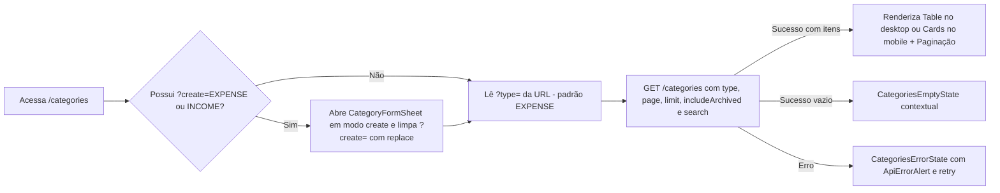

# Listagem, Filtros, URL State e Paginação de Categorias

Descreve a navegação em `/categories`, a troca entre abas de despesa e receita, a busca com debounce, a visualização de categorias arquivadas e o consumo do deep link `?create=`.

## Atores, Pré-condições e Pontos de Entrada

- **Ator:** usuário autenticado com e-mail verificado.
- **Rotas frontend:** `/categories` (protegida por `PrivateRoute`; título `Danfy | Categorias`).
- **Pontos de entrada:**
  - Navegação principal do `AuthAppShell` (sidebar desktop e menu "Mais" no mobile).
  - Atalho rápido `MobileQuickActions` ("Nova categoria de despesa" → `/categories?create=EXPENSE`).

## Fluxo Principal e Alternativos

1. **Abas de tipo (`Despesas` / `Receitas`):**
   - `parseCategoryManagementType` interpreta `?type=INCOME` como `'INCOME'`; qualquer outro valor ou ausência assume `'EXPENSE'`.
   - Trocar de aba atualiza a query string (omitindo `type` para `EXPENSE`) e reseta `page` para `1`.
2. **Busca expansível (`CategorySearch`):**
   - Inicia recolhida como botão de lupa (destacado em `state-info` quando há termo ativo).
   - Ao digitar, `searchDraft` é aplicado a `search` após debounce de `300ms` (`CATEGORY_SEARCH_DEBOUNCE_MS`), resetando `page` para `1`.
   - Apenas termos não vazios após `trim()` são enviados no parâmetro `search` de `GET /categories`.
3. **Visão de arquivadas:**
   - Acionada pelo menu `⋮` no cabeçalho (destacado em `state-warning` quando ativo).
   - Alterna `archiveView` entre `'active'` (`includeArchived: false`) e `'archived'` (`includeArchived: true`), resetando `page` para `1`.
   - `CategoriesPage` aplica também um filtro defensivo no cliente garantindo `category.type === activeType && category.isArchived === (archiveView === 'archived')`.
4. **Paginação (`CategoriesPagination`):**
   - Exibida apenas quando há itens visíveis (`visibleCategories.length > 0`).
   - Permite escolher tamanho de página (`10`, `20`, `50`, `100` — reseta `page` para `1`) e navegar entre Primeira, Anterior, Próxima e Última página.

## Estados de Interface e Recuperação

| Estado | Comportamento observado | Recuperação / Próximo passo |
| --- | --- | --- |
| Loading inicial | `CategoriesSkeleton` (6 linhas pulsantes) | Aguarda `GET /categories` |
| Refetch em segundo plano | Texto discreto `Atualizando categorias...` mantendo a lista visível | Atualização automática |
| Empty (com busca ativa) | `Nenhuma categoria encontrada` (sem CTA de criação) | Limpar busca |
| Empty (visão arquivadas) | `Sem <tipo> arquivadas` (sem CTA de criação) | Voltar para ativas |
| Empty (ativas sem busca) | `Nenhuma categoria de <tipo> ainda` + `CategoryCreateButton` | Abrir criação |
| Error | `CategoriesErrorState` com `ApiErrorAlert` (`categories.list`) | Botão `Tentar novamente` (`refetch()`) |

## Segurança e Privacidade

- Sessão exclusivamente via cookies HttpOnly (`withCredentials: true`); nenhum `userId` é trafegado pelo frontend.
- `401` aciona refresh centralizado; `403 EMAIL_VERIFICATION_REQUIRED` redireciona para `/email-verification-pending`.

## Consumo de Backend

| Operação | Autenticação | Contrato relevante | Efeito / Cache | Erros e recuperação | Fonte |
| --- | --- | --- | --- | --- | --- |
| `GET /categories` | Cookie HttpOnly | Query `page`, `limit`, `type`, `includeArchived`, `search?` | `['categories', params]` (`staleTime: 30s`, `retry < 2`) | `CATEGORY_INVALID_LIST_QUERY`, `401`, `429`, `5xx` → `ApiErrorAlert` + retry | `personal-finance-backend:docs/integrations/categories/list-categories.md` |
