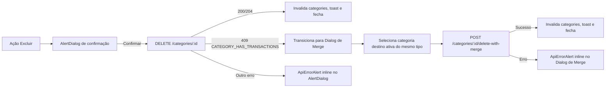

# Ciclo de Vida de Categorias: Criar, Editar, Arquivar e Excluir/Merge

Descreve todas as mutações sobre categorias personalizadas em `/categories`, incluindo validação de formulário, feedback de erro e o fluxo de contingência para merge quando há transações vinculadas.

## Atores, Pré-condições e Pontos de Entrada

- **Ator:** usuário autenticado com e-mail verificado.
- **Pré-condições:** para editar, arquivar ou excluir, a categoria precisa satisfazer `canManageCategory(category)`; para restaurar, `canRestoreCategory(category)`.
- **Pontos de entrada:**
  - `CategoryCreateButton` (cabeçalho ou empty state) ou deep link `/categories?create=EXPENSE|INCOME`.
  - Menu de ações (`CategoryActionsMenu`) em cada linha da tabela desktop ou card mobile.

## Fluxo 1 — Criar e Editar Categoria (`CategoryFormSheet`)

1. Ao abrir em modo `create`, o sheet assume o tipo da aba/intenção (`EXPENSE` ou `INCOME`) com defaults de cor/ícone por tipo, `includeInReports: true` e `sortOrder: 0`.
2. Ao abrir em modo `edit`, o formulário preenche os valores atuais da categoria sem permitir alterar `type`.
3. O sheet consome `GET /categories/metadata` (`staleTime: 10 min`) e exibe as `5` primeiras opções de cor e ícone inline (`VISIBLE_METADATA_OPTIONS = 5`), movendo as demais para menus de overflow (`DropdownMenu`). Se o endpoint falhar, o catálogo local mantém o formulário utilizável.
4. Na submissão, `categoryFormSchema` valida os campos antes do envio (`POST /categories` ou `PATCH /categories/:id`).
5. Em sucesso: invalida `['categories']`, exibe toast de sucesso e fecha o sheet.
6. Em falha: preserva todos os campos digitados, mapeia `VALIDATION_ERROR.details.fields` via `applyApiFieldErrors` (focando o primeiro campo inválido) e exibe `ApiErrorAlert` inline (`categories.create` / `categories.update`).

## Fluxo 2 — Arquivar e Restaurar Categoria

1. Acionado diretamente no `CategoryActionsMenu` (sem modal de confirmação).
2. Dispara `PATCH /categories/:id/archive` ou `PATCH /categories/:id/unarchive`.
3. Enquanto pendente (`isMutating`), os itens do menu ficam desabilitados.
4. Em sucesso: invalida `['categories']` e exibe toast de confirmação.
5. Em erro: dispara toast destrutivo via `showApiErrorToast` (`categories.archive` / `categories.unarchive`).

## Fluxo 3 — Excluir e Excluir com Merge (`CategoryDeleteDialogs`)

1. `AlertDialog` pede confirmação explícita antes de chamar `DELETE /categories/:id`.
2. Se o backend retornar `CATEGORY_HAS_TRANSACTIONS`, `CategoryDeleteDialogs` alterna automaticamente para `mode: 'merge'` (`Dialog`), mantendo o usuário no contexto sem perder a intenção.
3. O dialog lista apenas categorias elegíveis do mesmo tipo (`target.id !== category.id && !target.isArchived && target.isEditable && target.isVisibleInManagement && target.type === targetType`).
4. Caso não existam destinos elegíveis, o botão de confirmação permanece desabilitado com orientação para criar/restaurar outra categoria do mesmo tipo primeiro.
5. Ao confirmar, envia `POST /categories/:id/delete-with-merge` com `{ targetCategoryId }`. Ao fechar qualquer dialog, `targetCategoryId` e erros de mutação são resetados.

## Estados de Interface e Recuperação

| Operação | Pending | Erro / Recuperação |
| --- | --- | --- |
| Criar / Editar | Botão `Salvando...` desabilitado | `applyApiFieldErrors` + `ApiErrorAlert` inline; dados preservados |
| Arquivar / Restaurar | Menu desabilitado (`isMutating`) | `showApiErrorToast` destrutivo |
| Excluir | Botão de confirmação desabilitado | `CATEGORY_HAS_TRANSACTIONS` abre merge; outros erros em `ApiErrorAlert` no `AlertDialog` |
| Excluir com merge | Botão desabilitado; exige destino selecionado | `ApiErrorAlert` inline no `Dialog` (`categories.merge-delete`) |

## Consumo de Backend

| Operação | Autenticação | Contrato relevante | Efeito / Cache | Erros e recuperação | Fonte |
| --- | --- | --- | --- | --- | --- |
| `GET /categories/metadata` | Cookie HttpOnly | Retorna `{ icons, colors }` | `['categories', 'metadata']` (`staleTime: 10m`) | Fallback silencioso para catálogo local | `personal-finance-backend:docs/integrations/categories/get-category-metadata.md` |
| `POST /categories` | Cookie HttpOnly | `CreateCategoryDto` | Invalida `['categories']` + toast | `VALIDATION_ERROR`, `CATEGORY_NAME_ALREADY_EXISTS`, `TECHNICAL_CATEGORY_CANNOT_BE_CREATED` → inline + field errors | `personal-finance-backend:docs/integrations/categories/create-category.md` |
| `PATCH /categories/:id` | Cookie HttpOnly | `UpdateCategoryDto` (sem `type`) | Invalida `['categories']` + toast | `VALIDATION_ERROR`, `CATEGORY_NAME_ALREADY_EXISTS`, `CATEGORY_NOT_MANAGEABLE`, `CATEGORY_UPDATE_EMPTY`, `CATEGORY_NOT_FOUND` → inline + field errors | `personal-finance-backend:docs/integrations/categories/update-category.md` |
| `PATCH /categories/:id/archive` | Cookie HttpOnly | Path `:id` | Invalida `['categories']` + toast | `CATEGORY_NOT_FOUND`, `CATEGORY_NOT_MANAGEABLE` → `showApiErrorToast` | `personal-finance-backend:docs/integrations/categories/archive-category.md` |
| `PATCH /categories/:id/unarchive` | Cookie HttpOnly | Path `:id` | Invalida `['categories']` + toast | `CATEGORY_NOT_FOUND`, `CATEGORY_NOT_MANAGEABLE` → `showApiErrorToast` | `personal-finance-backend:docs/integrations/categories/unarchive-category.md` |
| `DELETE /categories/:id` | Cookie HttpOnly | Path `:id` | Invalida `['categories']` + toast | `CATEGORY_HAS_TRANSACTIONS` → abre merge; demais erros em `ApiErrorAlert` | `personal-finance-backend:docs/integrations/categories/delete-category.md` |
| `POST /categories/:id/delete-with-merge` | Cookie HttpOnly | `{ targetCategoryId }` | Invalida `['categories']` + toast | `CATEGORY_INVALID_MERGE`, `CATEGORY_NOT_FOUND`, `CATEGORY_NOT_MANAGEABLE` → `ApiErrorAlert` | `personal-finance-backend:docs/integrations/categories/delete-category-with-merge.md` |
