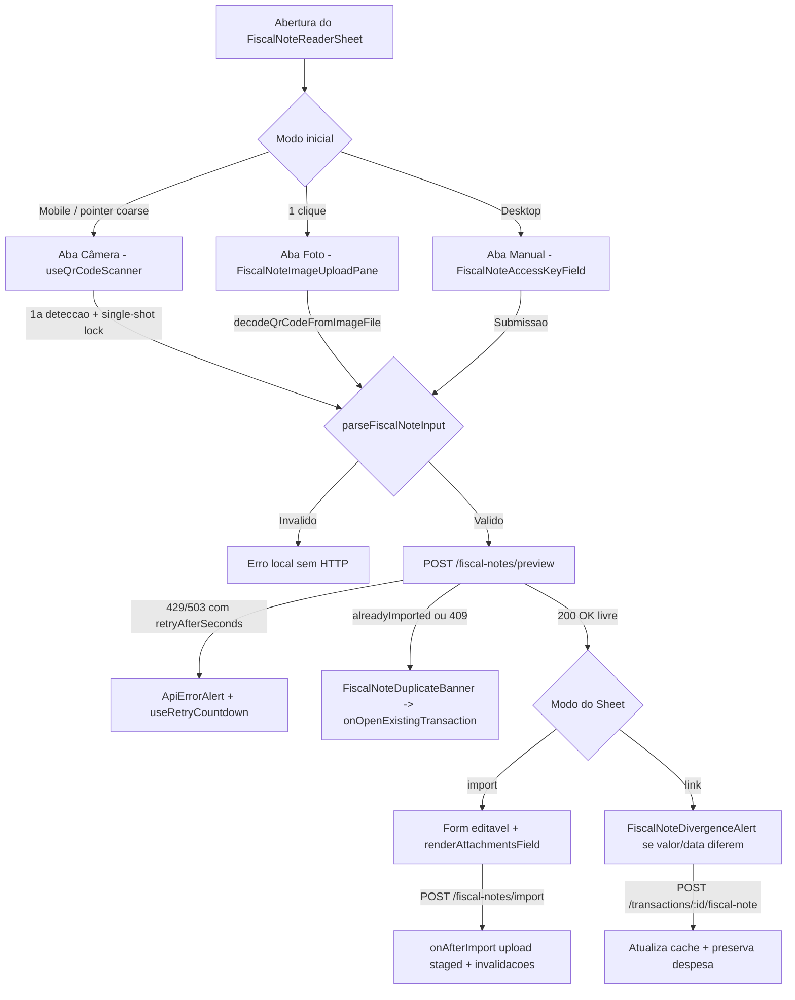

# Importação, Vínculo, Consulta e Desvínculo de NFC-e

Descreve os fluxos completos de captura de NFC-e da SEFAZ-CE, consulta de prévia, recuperação de duplicata, importação como nova despesa (com anexos em staging), vínculo em despesa existente (com detecção de divergência), visualização da lista de compras e desvínculo isolado.

## Atores, Pré-condições e Pontos de Entrada

- **Ator:** usuário autenticado com e-mail verificado.
- **Rota principal de orquestração:** `/transactions` (`TransactionsPage`). Não há rota dedicada para `/fiscal-notes` na V1.
- **Pontos de entrada — Modo `import` (nova despesa):**
  1. Botão **"Ler NFC-e"** na barra de ações de `/transactions` nas visões `ALL` e `EXPENSE` (desktop) ou no menu `...` (mobile).
  2. Atalho **"Ler NFC-e"** no `MobileQuickActions` (`AuthAppShell`), navegando para `/transactions?view=EXPENSE&create=FISCAL_NOTE` (o parâmetro `create` é consumido e removido da URL com `replace: true`).
  3. Atalho **"Importar via NFC-e"** dentro de `TransactionFormSheet` quando em modo `create` e `type === 'EXPENSE'`.
- **Pontos de entrada — Modo `link` (despesa existente):**
  1. Seção **Nota fiscal** em `TransactionDetailsSheet` quando `type === 'EXPENSE'` e `!transaction.hasFiscalNote`.
  2. Item **"Vincular NFC-e"** no menu contextual `...` de `TransactionsTable` (apenas `EXPENSE` sem nota vinculada).
- **Pontos de entrada — Consulta e Desvínculo:**
  - Card `FiscalNoteSummaryCard` em `TransactionDetailsSheet` (quando `type === 'EXPENSE'` e `hasFiscalNote === true`) → abre `FiscalNoteDetailsSheet` (*"Ver lista completa"*) ou `FiscalNoteUnlinkDialog` (*"Desvincular"*).

## Fluxo Principal — Captura, Preview, Import e Link

### Etapa 1 — Captura em 3 Abas (`FiscalNoteReaderSheet`)
1. Ao abrir, `prefersCameraViewport(useIsMobile())` escolhe **`camera`** em viewports mobile/touch e **`manual`** em desktop; após interação manual do usuário, a escolha é preservada durante a sessão do sheet.
2. **Aba `camera` (`FiscalNoteQrScannerPane` + `useQrCodeScanner`):**
   - Solicita câmera traseira (`facingMode: { ideal: 'environment' }`) em contexto seguro (`HTTPS` ou `localhost`).
   - Executa `detector.detect(video)` via `requestAnimationFrame` com throttle de `250 ms` (`FISCAL_NOTE_QR_SCANNER_THROTTLE_MS`) e guard de concorrência.
   - Ao ler o primeiro QR Code não vazio, ativa a trava single-shot (`status = 'paused'`) evitando chamadas duplicadas; oferece controles de troca de câmera e lanterna (`torch`) quando suportados e botões de fallback imediato para **Foto** ou **Manual** em erros de permissão/hardware/contexto inseguro.
3. **Aba `image` (`FiscalNoteImageUploadPane`):** aceita `PNG`, `JPEG` ou `WebP` até `10 MB` (`FISCAL_NOTE_MAX_IMAGE_SIZE_BYTES`) por clique ou drag-and-drop e decodifica localmente via `decodeQrCodeFromImageFile`.
4. **Aba `manual` (`FiscalNoteAccessKeyField`):** aceita URL do QR Code, payload `p` ou chave numérica de 44 dígitos (exibida em blocos de 4 dígitos).
5. Toda entrada passa por `parseFiscalNoteInput` antes do request HTTP; falhas locais mantêm o usuário na Etapa 1.

### Etapa 2A — Tratamento Proativo e Concorrente de Duplicata
- Se `preview.alreadyImported === true` ou se qualquer mutação (`preview`, `import`, `link`) retornar `409 FISCAL_NOTE_ALREADY_IMPORTED` (`parseFiscalNoteAlreadyImportedDetails`), o `FiscalNoteDuplicateBanner` é exibido, os botões de confirmação são bloqueados e o botão **"Ver despesa existente"** chama `onOpenExistingTransaction(existingTransactionId)`.
- Em `TransactionsPage`, `handleOpenExistingTransaction` busca `GET /transactions/:id` (`getTransactionById` via `queryClient.fetchQuery`), fecha `FiscalNoteReaderSheet` e abre `TransactionDetailsSheet` diretamente com a despesa encontrada — mesmo que ela pertença a outro mês ou página não carregada.

### Etapa 2B — Importação com Staging de Anexos (`mode === 'import'`)
1. O formulário (`fiscalNoteImportSchema`) é pré-preenchido com `suggestedTransaction` (`amountCents`, `date`, `description`, `status: 'EFFECTIVE'`), `accountId` padrão (se existir conta não arquivada com `isDefault`) e `categoryId` de despesa. Se `fiscalNote.payableAmountCents === 0`, um aviso orienta o usuário e o schema exige `amountCents >= 1`.
2. O slot `renderAttachmentsField` renderiza `TransactionStagedAttachmentsField` (até 3 arquivos `PNG`/`JPEG`/`WebP` de até 5 MB com preview e reordenação).
3. Ao confirmar, `useImportFiscalNote` envia `POST /fiscal-notes/import` com `{ input, accountId, categoryId, amountCents, date, description, status }` (sem enviar itens).
4. Em `201 Created`, `onAfterImport(result)` envia os arquivos em staging via `uploadTransactionAttachments(result.transaction.id, files)`. Se o upload dos comprovantes falhar, um toast destrutivo avisa que **a despesa e a NFC-e foram salvas** e o sheet **fecha mesmo assim** para evitar duplicação acidental.

### Etapa 2C — Vínculo a Despesa Existente (`mode === 'link'`)
1. `computeFiscalNoteDivergence` compara `linkTarget.amountCents` vs. `fiscalNote.payableAmountCents` e `linkTarget.date` vs. `fiscalNote.issuedDate`.
2. Havendo diferença em valor ou data, `FiscalNoteDivergenceAlert` (`state-warning`) contrasta os dois valores/datas e reforça que **a despesa existente não será alterada**.
3. Ao confirmar, `useLinkFiscalNote` envia `POST /transactions/:id/fiscal-note` com `{ input }`.

### Consulta da Lista de Compras e Desvínculo Isolado
1. Em `TransactionDetailsSheet` (apenas `EXPENSE`), quando `transaction.hasFiscalNote === true`, `useTransactionFiscalNote(transaction.id)` consulta `GET /transactions/:id/fiscal-note` sob demanda.
2. `FiscalNoteSummaryCard` exibe emitente, nº/série, data de emissão, total, desconto (se `> 0`) e prévia dos **3 primeiros itens** ordenados por `position`, com ação **"Ver lista completa (N itens)"** (abre `FiscalNoteDetailsSheet` com busca em tempo real por descrição ou `storeCode`, totais, pagamentos e metadados fiscais com chave copiável) e **"Desvincular"**.
3. **"Desvincular"** abre `FiscalNoteUnlinkDialog` (`AlertDialog`), deixando explícito que a nota e a lista de compras serão removidas, a despesa e os saldos permanecerão intactos e a chave será liberada. Confirmando, `useUnlinkFiscalNote` executa `DELETE /transactions/:id/fiscal-note`, remove o cache da nota e fecha `FiscalNoteDetailsSheet` e o diálogo, atualizando o estado do `TransactionDetailsSheet`.

## Estados de Interface e Recuperação

| Estado | Comportamento observado | Recuperação / Próximo passo |
| --- | --- | --- |
| Câmera negada/ausente/HTTP inseguro | Painel de fallback em `FiscalNoteQrScannerPane` sem quebrar o sheet | `Tentar novamente`, `Enviar foto do QR` ou `Digitar chave / URL` |
| QR ausente na imagem | Mensagem local em `FiscalNoteImageUploadPane` mantendo o usuário na Etapa 1 | Escolher outra foto ou alternar para entrada manual |
| Loading de preview | Status `aria-live="polite"` (*"Consultando NFC-e na SEFAZ-CE..."*) | Aguarda resolução sem desmontar o sheet |
| Rate limit / SEFAZ indisponível (`429`/`503`) | `ApiErrorAlert` + `useRetryCountdown` desabilita reenvio até zerar `retryAfterSeconds` | Aguardar contagem regressiva e tentar novamente |
| Duplicata (`alreadyImported` / `409`) | `FiscalNoteDuplicateBanner` desabilita import/link | `Ver despesa existente` ou `Ler outra nota` |
| Erro ao carregar nota no detalhe | `Skeleton` substituído por `ApiErrorAlert` (`fiscal-notes.get`) | Botão `Tentar novamente` (`refetch`) |

## Consumo de Backend

| Operação | Autenticação | Contrato relevante | Efeito / Cache | Erros e recuperação | Fonte |
| --- | --- | --- | --- | --- | --- |
| `POST /fiscal-notes/preview` | Cookie HttpOnly | `{ input }` | Mutation `retry: false`; sem cache persistido | `400`, `404`, `409`, `422`, `429`/`503` (countdown), `502`/`504` (`fiscal-notes.preview`) | `personal-finance-backend:docs/fiscal-notes/reference/http-and-error-contracts.md` |
| `POST /fiscal-notes/import` | Cookie HttpOnly | `{ input, accountId, categoryId, amountCents?, date?, description?, status? }` | `setQueryData(byTransaction(tx.id))`, invalida `['transactions']`, `['accounts']`, `['dashboard']` | `applyApiFieldErrors`, `409` duplicata, `ApiErrorAlert` (`fiscal-notes.import`) | `personal-finance-backend:docs/fiscal-notes/flows/import-link-and-lifecycle.md` |
| `POST /transactions/:id/fiscal-note` | Cookie HttpOnly | `{ input }` em `EXPENSE` sem nota | `setQueryData(byTransaction(id))`, invalida `['transactions']` e `['transactions', 'detail', id]` | `409` duplicata / já possui nota / tipo inválido, `ApiErrorAlert` (`fiscal-notes.link`) | `personal-finance-backend:docs/fiscal-notes/flows/import-link-and-lifecycle.md` |
| `GET /transactions/:id/fiscal-note` | Cookie HttpOnly | Somente quando `hasFiscalNote === true` | `['fiscal-notes', 'transaction', id]` (`staleTime: 5 min`, sem retry em `404`) | `ApiErrorAlert` + retry (`fiscal-notes.get`) | `personal-finance-backend:docs/fiscal-notes/reference/http-and-error-codes.md` |
| `DELETE /transactions/:id/fiscal-note` | Cookie HttpOnly | Path `:id`; preserva transação e libera chave | `removeQueries(byTransaction(id))`, invalida `['transactions']` e `['transactions', 'detail', id]` | `ApiErrorAlert` no `FiscalNoteUnlinkDialog` (`fiscal-notes.unlink`) | `personal-finance-backend:docs/fiscal-notes/flows/import-link-and-unlink.md` |
