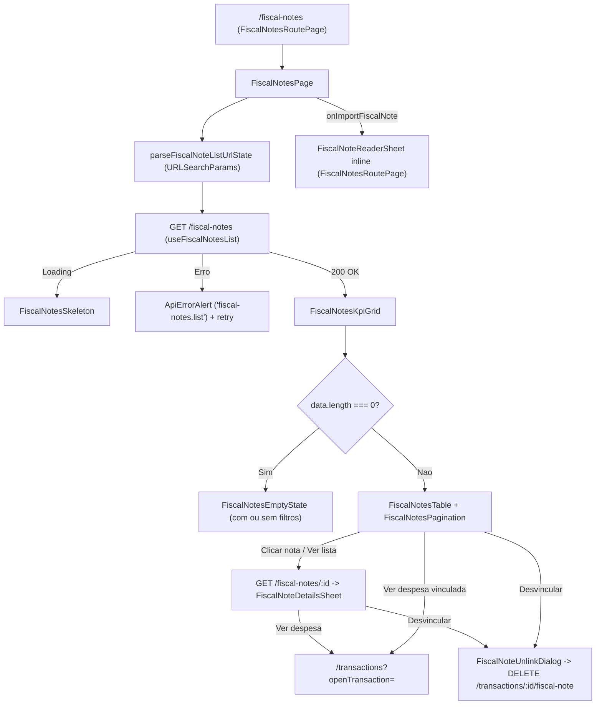

# Listagem, Busca, Filtros em URL e Inspeção Direta (`/fiscal-notes`)

Descreve o fluxo ponta a ponta da tela dedicada `/fiscal-notes`: sincronização de busca/filtros/ordenação/paginação na URL, indicadores do recorte (`summary`), abertura sob demanda dos detalhes via `GET /fiscal-notes/:id`, leitor inline (**Ler NFC-e**), desvínculo e deep-link `?openTransaction=<id>` para `/transactions`.

## Atores, Pré-condições e Pontos de Entrada

- **Ator:** usuário autenticado com e-mail verificado (`ACTIVE`).
- **Rota frontend:** `/fiscal-notes` (`PrivateRoute`, título `Danfy Finance | Notas fiscais`), montada pelo compositor fino `src/app/pages/FiscalNotesRoutePage.tsx` dentro de `AuthAppShell` (`activeSection="fiscal-notes"`).
- **Pontos de entrada na navegação (`AuthAppShell`):**
  1. **Desktop:** 5º item da sidebar lateral (*Notas fiscais* — *"NFC-e e compras"*), logo abaixo de *Transações*.
  2. **Mobile:** topo do sheet *Mais* (*Notas fiscais* — *"NFC-e e histórico de compras"*), preservando os 5 slots da barra inferior.

## Fluxo Principal

## Estado Sincronizado na URL (`fiscalNoteListUrl.utils.ts`)

`parseFiscalNoteListUrlState` e `buildFiscalNoteListSearchParams` governam os parâmetros compartilháveis da listagem, omitindo valores vazios/nulos e padrões (`page=1`, `limit=20`, `sort=issuedAt:desc`) enquanto preservam `0` em limites de valor:

| Parâmetro URL | Parâmetro API (`GET /fiscal-notes`) | Padrão / Comportamento |
| --- | --- | --- |
| `q` | `search` | Busca por estabelecimento ou descrição de item (`maxLength: 120`), com debounce de `350 ms` no input e reset de `page` para `1` |
| `issuedFrom` / `issuedTo` | `issuedFrom` / `issuedTo` | `DateOnly` (`YYYY-MM-DD`). Iniciam `null` (**todo o histórico** por padrão); intervalos com `issuedFrom > issuedTo` são descartados |
| `minAmountCents` / `maxAmountCents` | `minAmountCents` / `maxAmountCents` | Inteiros não negativos em centavos (`>= 0`); intervalos com `minAmountCents > maxAmountCents` são descartados |
| `issuerCnpj` | `issuerCnpj` | Normalizado para exatos 14 dígitos numéricos (valores parciais na URL são ignorados) |
| `sourceUf` | `sourceUf` | Código UF de 2 dígitos (ex.: `'23'` para Ceará) |
| `sort` | `sort` | Allowlist fechada de 6 opções (`issuedAt:desc` por padrão) |
| `page` / `limit` | `page` / `limit` | `page >= 1` (padrão `1`); `limit` `1..100` com opções de UI `10`, `20` (padrão) e `50` |

## Busca, Ordenação, Drawer de Filtros e Chips

1. **Busca (`q`):** barra superior filtra por nome do estabelecimento ou descrição dos itens comprados (enviado ao backend como `search`), com botão limpar (`X`) e debounce de `350 ms`.
2. **Ordenação (`sort`):** seletor direto com 6 opções (`Mais recentes (emissão)`, `Mais antigas (emissão)`, `Maior valor pago`, `Menor valor pago`, `Importadas recentemente`, `Importadas primeiro`).
3. **Drawer de filtros (`FiscalNotesFiltersSheet`):**
   - **Presets de período:** *Este mês*, *Últimos 30 dias*, *Últimos 90 dias* e *Todo o período* — calculados em `DateOnly` civil sem deriva de fuso/horário de verão (`shiftCivilDateDays`, `getTodayDateOnly`, `getMonthStartDateOnly`, `getMonthEndDateOnly`).
   - **Faixa de valor pago:** `CurrencyInput` em centavos (`Valor mínimo` / `Valor máximo`).
   - **CNPJ do emitente:** máscara progressiva `00.000.000/0000-00` (`formatCnpjMask` / `normalizeCnpjDigits`); exige 14 dígitos completos quando preenchido.
   - **UF emissora:** seletor com *Todas as UFs* e opções suportadas (`FISCAL_NOTE_SUPPORTED_UF_OPTIONS`: `'23' — Ceará (CE)`).
   - **Validação local antes de aplicar:** bloqueia `issuedFrom > issuedTo`, `minAmountCents > maxAmountCents` e CNPJ incompleto (`1..13` dígitos).
4. **Chips ativos (`FiscalNotesActiveFiltersBar`):** exibe chips removíveis para período, faixa de valor, CNPJ e UF + botão *Limpar filtros* (contagem exibida no badge do botão *Filtros*).

## KPIs, Tabela, Paginação e Inspeção Lazy (`GET /fiscal-notes/:id`)

1. **Indicadores (`FiscalNotesKpiGrid`):** 4 cards do recorte filtrado (`data.summary`): *Total pago* (`totalPayableAmountCents`), *Notas fiscais* (`totalNotes`), *Descontos* (`totalDiscountAmountCents`) e *Tributos aprox.* (`totalTaxAmountCents`).
2. **Listagem (`FiscalNotesTable` + `FiscalNotesPagination`):**
   - **Desktop (`md+`):** tabela com estabelecimento (nome, CNPJ, nº/série), emissão (`formatDateTime`), badge de contagem de itens (`itemsCount`), desconto (`.numeric` em `state-income` quando `> 0`), total pago e menu `...`.
   - **Mobile (`< md`):** cards clicáveis com menu `...` isolado.
   - **Paginação:** exibe página atual, total de páginas/notas, seletor `Por página` (`10`, `20`, `50`) e botões `Anterior`/`Próxima`, mantendo os dados anteriores visíveis durante paginação/refetch (`keepPreviousData`).
3. **Detalhe sob demanda (`GET /fiscal-notes/:id`):**
   - Clicar em uma linha/card ou em *"Ver lista de compras"* seleciona a nota e habilita `useFiscalNoteById(selectedNoteSummary?.id)`.
   - `FiscalNoteDetailsSheet` exibe skeleton durante o carregamento, `ApiErrorAlert` (`fiscal-notes.get`) com *Tentar novamente* em erro, e quando carregado renderiza `FiscalNoteItemsList` (com busca local), `FiscalNoteTotalsCard`, `FiscalNotePaymentsList`, `FiscalNoteMetadataBlock` e rodapé com **Desvincular NFC-e**, **Ver despesa** e **Fechar**.
4. **Salto para `/transactions?openTransaction=<id>`:**
   - Acionado por *"Ver despesa vinculada"* no menu `...` da tabela/card ou *"Ver despesa"* no `FiscalNoteDetailsSheet` (via `FiscalNotesRoutePage.openTransactionInPage`).
   - Também é acionado quando o leitor inline em `/fiscal-notes` detecta uma nota duplicada (`Ver despesa existente`).
   - Em `/transactions`, `TransactionsPage` consome `openTransaction`, limpa o parâmetro da URL com `{ replace: true }`, busca `GET /transactions/:id`, sincroniza o período para o mês da transação e abre `TransactionDetailsSheet`.
5. **Leitor inline e desvínculo:**
   - O botão **Ler NFC-e** (header e empty state sem filtros) aciona `onImportFiscalNote` em `FiscalNotesRoutePage`, abrindo `FiscalNoteReaderSheet` em modo `import` com contas, categorias de despesa e staging de anexos sem sair de `/fiscal-notes`.
   - **Desvincular NFC-e** abre `FiscalNoteUnlinkDialog`; ao concluir `DELETE /transactions/:id/fiscal-note`, invalida `lists()` e `details()`, remove `byTransaction(transactionId)` e fecha o `FiscalNoteDetailsSheet` caso a nota removida estivesse aberta.

## Estados de Interface e Recuperação

| Estado | Comportamento observado | Recuperação |
| --- | --- | --- |
| Carregamento inicial | `FiscalNotesSkeleton` (4 KPIs + 5 linhas) | Aguarda `GET /fiscal-notes` |
| Refetch / mudança de página | Dados anteriores mantidos (`keepPreviousData`) + aviso `aria-live="polite"` (*"Atualizando notas fiscais..."*) | Aguarda atualização sem perder contexto visual |
| Vazio sem filtros | `FiscalNotesEmptyState` orientando leitura da primeira NFC-e | Botão *"Ler primeira NFC-e"* |
| Vazio com busca/filtros | `FiscalNotesEmptyState` informando ausência de resultados | Botão *"Limpar filtros"* (limpa busca e filtros avançados) |
| Erro na listagem | `ApiErrorAlert` no contexto `'fiscal-notes.list'` (override para filtros inválidos em `400 FISCAL_NOTE_INVALID_INPUT`) | Botão *Tentar novamente* (`refetch`) |
| Loading / erro no detalhe | Skeleton dedicado ou `ApiErrorAlert` (`'fiscal-notes.get'`) dentro de `FiscalNoteDetailsSheet` | Botão *Tentar novamente* (`detailQuery.refetch`) ou *Fechar* |

## Consumo de Backend

| Operação | Autenticação | Contrato relevante | Efeito / Cache | Erros e recuperação | Fonte |
| --- | --- | --- | --- | --- | --- |
| `GET /fiscal-notes` | Cookie HttpOnly | `issuedFrom`, `issuedTo`, `issuerCnpj`, `sourceUf`, `minAmountCents`, `maxAmountCents`, `search`, `page`, `limit`, `sort` | `['fiscal-notes', 'list', params]` (`staleTime: 30s`, `keepPreviousData`, `retry < 2`) | `ApiErrorAlert` + retry (`fiscal-notes.list`) | `personal-finance-backend:docs/fiscal-notes/reference/http-and-error-contracts.md` |
| `GET /fiscal-notes/:id` | Cookie HttpOnly | Path `:id` UUID | `['fiscal-notes', 'detail', id]` (`staleTime: 5 min`, sem retry em `404` / `FISCAL_NOTE_NOT_FOUND`) | `ApiErrorAlert` + retry dentro do sheet (`fiscal-notes.get`) | `personal-finance-backend:docs/fiscal-notes/reference/http-and-error-contracts.md` |
| `DELETE /transactions/:id/fiscal-note` | Cookie HttpOnly | Path `:transactionId` | Remove `byTransaction(txId)`, invalida `lists()`, `details()`, `transactions`, `transactionDetail(txId)` | `ApiErrorAlert` no `FiscalNoteUnlinkDialog` (`fiscal-notes.unlink`) | `personal-finance-backend:docs/fiscal-notes/flows/import-link-and-lifecycle.md` |
