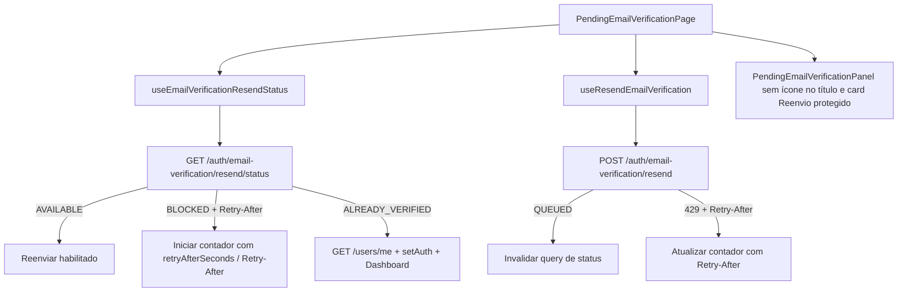

# Design — verificação de email e status de reenvio

## Resumo da solução

A solução aprimora a experiência da rota autenticada `/email-verification-pending` consumindo o endpoint `GET /auth/email-verification/resend/status` via TanStack Query com polling contínuo enquanto a página estiver montada.



## Arquitetura e Contratos

### Contratos e Constantes

- `src/features/auth/constants/auth.constants.ts`
  - Endpoint: `emailVerificationResendStatus: '/auth/email-verification/resend/status'`
  - Query Key: `emailVerificationResendStatus: ['auth', 'email-verification', 'resend-status'] as const`

### Tipagem e Schemas

Em `src/features/auth/types/auth.types.ts`:

```ts
export type EmailVerificationResendStatusResponse =
  | {
      object: 'email_verification.resend_status.available'
      status: 'AVAILABLE'
      available: true
      manualResendsUsed: number
      manualResendsRemaining: number
      manualResendLimit: number
      windowSeconds: number
      lastLogicalSendAt: string | null
    }
  | {
      object: 'email_verification.resend_status.blocked'
      status: 'BLOCKED'
      available: false
      blockedBy: 'COOLDOWN' | 'DAILY_LIMIT' | 'OPERATION_PENDING'
      retryAfterSeconds: number
      manualResendsUsed: number
      manualResendsRemaining: number
      manualResendLimit: number
      windowSeconds: number
      lastLogicalSendAt: string | null
    }
  | {
      object: 'email_verification.resend_status.already_verified'
      status: 'ALREADY_VERIFIED'
      available: false
    }

export type EmailVerificationResendAvailability =
  | {
      status: 'AVAILABLE'
      available: true
      retryAfterSeconds: null
      retryAtMs: null
      manualResendsUsed: number
      manualResendsRemaining: number
      manualResendLimit: number
    }
  | {
      status: 'BLOCKED'
      available: false
      blockedBy: 'COOLDOWN' | 'DAILY_LIMIT' | 'OPERATION_PENDING'
      retryAfterSeconds: number | null
      retryAtMs: number | null
      manualResendsUsed: number
      manualResendsRemaining: number
      manualResendLimit: number
    }
  | {
      status: 'ALREADY_VERIFIED'
      available: false
      retryAfterSeconds: null
      retryAtMs: null
    }
```

### Parser de Disponibilidade

Criar utilitário `src/features/auth/utils/emailVerificationStatus.ts`:
- `parseEmailVerificationResendStatusResponse(data: unknown): EmailVerificationResendStatusResponse | null`
- `buildEmailVerificationResendAvailability({ response, retryAfterHeader, receivedAtMs }): EmailVerificationResendAvailability`
- Extrai e valida números inteiros positivos de `Retry-After` ou `retryAfterSeconds`, calculando `retryAtMs = receivedAtMs + seconds * 1000`.

### Query de Polling

Adicionar em `src/features/auth/api/queries.ts`:
- `useEmailVerificationResendStatus(options?: { enabled?: boolean; refetchInterval?: number | false })`
- Configurado com `staleTime: 0`, `refetchOnMount: 'always'`, `refetchOnWindowFocus: true` e polling periódico (ex: 5000ms).

### Gerenciamento de Estado na Página

Em `PendingEmailVerificationPage.tsx`:
- Detecta nova entrada e lê o status retornado pela query.
- Se `data.status === 'BLOCKED'` e `retryAtMs` estiver presente, define `cooldownEndsAt = retryAtMs` e inicia contador com tick de 1 segundo.
- Se `data.status === 'ALREADY_VERIFIED'`, busca `fetchCurrentUser()`, atualiza Zustand/cache e redireciona ao dashboard com `{ replace: true }`.
- Ao submeter reenvio via `useResendEmailVerification`:
  - Em sucesso (`QUEUED`), invalida `AUTH_QUERY_KEYS.emailVerificationResendStatus` e sinaliza `resendQueued`.
  - Em `ALREADY_VERIFIED`, atualiza perfil e redireciona.
  - Em erro 429 (`EMAIL_VERIFICATION_COOLDOWN_ACTIVE` / `EMAIL_VERIFICATION_DAILY_LIMIT_EXCEEDED` / `TOO_MANY_REQUESTS`), extrai `retryAfterSeconds` e atualiza `cooldownEndsAt`.

### Ajustes Visuais no Organismo

Em `PendingEmailVerificationPanel.tsx`:
- Remover o badge de ícone de email acima do título.
- Remover o grid de 2 cards informativos ("Confira sua caixa de entrada" e o card antigo).
- Inserir card único destacado com o título `"Reenvio protegido"` e o texto `"Você pode solicitar um novo email respeitando o intervalo de segurança e o limite diário."`.
- Atualizar o botão de reenvio para exibir o tempo formatado durante cooldown ativo (ex: `Aguarde ${minutos} min` ou segundos quando < 60s).
- Utilizar estritamente tokens Danfy (`bg-card`, `border-border`, `bg-secondary`, `text-primary`, `text-foreground`, `text-muted-foreground`).

### Catálogo de Erros

Adicionar em `src/shared/errors/apiErrorCodes.ts`:
- `emailVerificationStateUnavailable: 'EMAIL_VERIFICATION_STATE_UNAVAILABLE'` (503)

Adicionar mapeamento em `src/shared/errors/resolveApiError.ts`:
- Mensagem amigável sem vazar detalhes técnicos do Redis.
