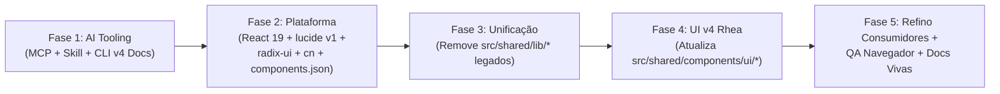

# Design — Atualização do Design System Danfy (shadcn v4 Rhea, React 19 e AI Tooling)

## Visão Arquitetural

A atualização é estruturada em **5 fases sequenciais e isoláveis**, garantindo que cada entrega termine com build, lint e testes verdes e possa ser validada como cliente real antes de avançar para a fase seguinte.



## Modelo de Execução (Supervisão e Delegação)

- **Orquestrador / Supervisor / Revisor:** mantém a spec viva, gerencia a Draft PR no GitHub, delega cada fase via Orca Orchestration (`orca orchestration worker-start --worktree current --agent antigravity --model gemini-4-hydrogen-high`), revisa o diff e executa testes reais de consumo (protocolo MCP, CLI, suite automatizada e navegador Orca).
- **Workers de implementação (`gemini-4-hydrogen-high`):** executam tarefas bem delimitadas por fase, com escopo explícito de arquivos e evidências obrigatórias (`lint`, `test`, `build`, `git diff`).

---

## Fase 1 — AI Tooling (MCP + Skill `shadcn` + CLI v4 Docs)

### 1.1 Configuração MCP
- **Claude Code (versionado no repositório):** criar `.mcp.json` na raiz:
  ```json
  {
    "mcpServers": {
      "shadcn": {
        "command": "npx",
        "args": ["shadcn@latest", "mcp"]
      }
    }
  }
  ```
- **Codex (configuração local da máquina):** adicionar em `~/.codex/config.toml` sem alterar nenhuma seção existente:
  ```toml
  [mcp_servers.shadcn]
  command = "npx"
  args = ["shadcn@latest", "mcp"]
  ```
- **Verificação real de consumo (Supervisor):**
  - Executar probe JSON-RPC (`initialize` → `notifications/initialized` → `tools/list` → `tools/call` de `get_project_registries` e `search_items_in_registries`) contra `npx shadcn@latest mcp`.
  - Confirmar que `.mcp.json` é JSON válido e `~/.codex/config.toml` permanece TOML válido.

### 1.2 Skill oficial `shadcn`
- Instalar em `.agents/skills/shadcn/` via `npx skills add shadcn/ui` (ou copiando de forma limpa para `.agents/skills/shadcn/` caso o instalador escreva fora do padrão canônico do repo, evitando arquivos temporários fora de `.agents/skills/`).
- Confirmar que `.claude/skills -> ../.agents/skills` expõe automaticamente `.claude/skills/shadcn/SKILL.md`.
- Se houver `.gemini/skills/` no workspace, garantir consistência sem quebrar o `.gitignore` / rastreamento do repositório.
- **Alinhamento de precedência com as skills Danfy:** documentar no `AGENTS.md` e `CLAUDE.md` que:
  - `shadcn` orienta descoberta de componentes, CLI v4, MCP e composição Radix;
  - `danfy-finance-design-system`, `frontend-design` e `material-3-ui-guidance` continuam sendo a autoridade final para tokens **Danfy Dark**, governança de cores, Atomic Design, Apple HIG e WCAG 2.2.

### 1.3 Governança CLI v4 em `AGENTS.md`, `CLAUDE.md` e `src/shared/AGENTS.md`
- Adicionar seção objetiva documentando:
  - MCP `shadcn` (Claude Code `.mcp.json` e snippet para Codex `~/.codex/config.toml`);
  - Skill `shadcn` na lista de skills do repositório;
  - Comandos essenciais da CLI v4:
    - `npx shadcn@latest info --json` (inspeção de contexto do projeto),
    - `npx shadcn@latest docs <componente>` (documentação + árvore de composição),
    - `npx shadcn@latest search` / `list` / `view` (descoberta no registry),
    - `npx shadcn@latest add <componente> --dry-run` / `--diff` / `--view` (obrigatório antes de sobrescrever componentes customizados do Danfy Dark).

---

## Fase 2 — Upgrade de Plataforma (React 19 + `lucide-react` v1 + `radix-ui` + `cn` + `components.json`)

### 2.1 Estratégia de Upgrade para React 19
Auditoria prévia de `peerDependencies` no `package.json` atual confirmou que **todas** as dependências de runtime e teste (`@tanstack/react-query@5.96`, `react-hook-form@7.72`, `react-router-dom@6.30`, `recharts@2.15`, `vaul@1.1`, `cmdk@1.1`, `sonner@2.0`, `react-day-picker@9.14`, `react-resizable-panels@4.10`, `react-imask@7.6`, `react-easy-crop@6.0`, `zustand@4.5`, `@testing-library/react@16.3`) já declaram compatibilidade com React 19 — exceto `lucide-react@0.356.0`.

- **Pacotes a atualizar:**
  - `react`: `^19.3.1`
  - `react-dom`: `^19.3.1`
  - `@types/react`: `^19.3.3`
  - `@types/react-dom`: `^19.3.0`
  - `lucide-react`: `^1.81.0`
- **Pontos de verificação obrigatórios em React 19 + `@types/react@19` + `lucide-react@1`:**
  1. `useRef<T>()` sem argumento inicial (React 19 exige valor inicial explícito — auditoria prévia mostrou que os `useRef` em `src/` já passam `null` ou objeto inicial, mas o `tsc` validará 100%).
  2. `React.ElementRef` (depreciado em favor de `React.ComponentRef` ou `React.ComponentProps` — na Fase 4 a maioria dos `forwardRef` em `ui/` será convertida para funções React 19 nativas).
  3. Ícones importados de `lucide-react` (verificar se algum ícone foi renomeado entre `0.356.0` e `1.81.0`, ex.: `Loader2`, `AlertCircle`, `CheckCircle2`, `Github`, etc., atualizando para o nome canônico v1).
  4. Compatibilidade de `eslint-plugin-react-hooks` e `@vitejs/plugin-react@6.0.2` com React 19.

### 2.2 `components.json` v4 (`radix-rhea`) e `shadcn/tailwind.css`
- Instalar `shadcn` em `devDependencies`.
- Atualizar `components.json`:
  ```json
  {
    "$schema": "https://ui.shadcn.com/schema.json",
    "style": "radix-rhea",
    "rsc": false,
    "tsx": true,
    "tailwind": {
      "config": "",
      "css": "src/index.css",
      "baseColor": "slate",
      "cssVariables": true
    },
    "iconLibrary": "lucide",
    "aliases": {
      "components": "@/shared/components",
      "utils": "@/shared/lib/utils",
      "ui": "@/shared/components/ui",
      "lib": "@/shared/lib",
      "hooks": "@/shared/hooks"
    }
  }
  ```
- Atualizar `src/index.css`:
  - Adicionar `@import 'shadcn/tailwind.css';` logo após `@import 'tw-animate-css';`.
  - Conferir tokens esperados pelo estilo **`radix-rhea`** (ex.: `--radius-4xl` / escala de radius derivada de `--radius`, `cn-font-heading`, variantes `data-open:` / `data-closed:` fornecidas por `shadcn/tailwind.css`) sem sobrescrever nem degradar nenhum token **Danfy Dark** (`--app-*`, `--brand*`, `--state-*`, `--account-*`, `--sidebar-*`, `.numeric`, scrollbar customizado).
  - Validar que `--radius` em `:root, .dark` gera cantos suaves e proporcionais no Rhea (`0.5rem` ou ajuste calibrado se necessário — documentado em `decisions.md`).

### 2.3 Migrações oficiais: `radix-ui` e `cn`
- Executar `npx shadcn@latest migrate radix -y` para substituir os 27 `@radix-ui/react-*` pelo pacote unificado **`radix-ui`**, removendo pacotes individuais sem referência.
- Executar `npx shadcn@latest migrate cn -y` (ou aplicar de forma controlada mantendo `src/shared/lib/utils.ts` como `export { cn } from 'cn'` para que tanto código novo com `import { cn } from 'cn'` quanto código existente com `import { cn } from '@/shared/lib/utils'` funcionem sem fricção), removendo `clsx` e `tailwind-merge` se não houver mais nenhum uso direto no repositório.

---

## Fase 3 — Consolidação dos Primitivos Legados (`src/shared/lib/*`)

### 3.1 Mapeamento de Substituição
| Legado (remover) | Canônico (manter) | Consumidores estimados |
| --- | --- | --- |
| `@/shared/lib/button` | `@/shared/components/ui/button` | ~40 arquivos |
| `@/shared/lib/card` | `@/shared/components/ui/card` | ~7 arquivos |
| `@/shared/lib/input` | `@/shared/components/ui/input` | ~6 arquivos |
| `@/shared/lib/label` | `@/shared/components/ui/label` | 1 arquivo (`_template`) |
| `@/shared/lib/toast` | `@/shared/components/ui/toast` | 1 arquivo (`Toaster.tsx`) |

### 3.2 Pontos de Atenção na Unificação
- `src/shared/lib/card.tsx` renderizava `CardTitle` como `<h3>` e `CardDescription` como `<p>`, enquanto o `ui/card.tsx` antigo renderizava `<div>`. Verificar testes (ex.: `getByRole('heading', ...)` em `LoginPage`, `DashboardPage`, `SecuritySettings`, `ErrorState`) para garantir que nenhum teste ou acessibilidade semântica de heading regrida!
- `src/shared/lib/button.tsx` e `src/shared/components/ui/button.tsx` têm a mesma API (`variant`, `size`, `asChild`, `ButtonProps`, `buttonVariants`); garantir que `ButtonProps` e `InputProps` permaneçam exportados se algum consumidor importar esses tipos.
- `Toaster.tsx` (`src/shared/components/organisms/Toaster.tsx`) continua sendo o ponto de montagem global de toasts com `useToast`, agora importando de `@/shared/components/ui/toast` (mantendo `src/shared/errors/showApiErrorToast.ts` e todos os testes de erro intactos).

---

## Fase 4 — Atualização dos Primitivos UI para shadcn v4 `radix-rhea`

### 4.1 Estratégia Controlada por Lotes
Em vez de sobrescrever cegamente os 55 arquivos, a atualização segue inspeção via `npx shadcn@latest add <comp> --diff` / `view` com preservação explícita de contratos Danfy:

1. **Lote 4A — Ações e Formulários:** `button`, `input`, `textarea`, `label`, `field`, `select`, `checkbox`, `radio-group`, `switch`, `slider`, `toggle`, `toggle-group`, `input-group`, `button-group`, `input-otp`, `form`.
   - **Cuidado especial com `button`:** verificar que todas as variantes usadas pelo app (`default`, `destructive`, `outline`, `secondary`, `ghost`, `link`) e tamanhos (`default`, `sm`, `lg`, `icon`, mais novos `xs`/`icon-xs`/`icon-sm`/`icon-lg` do Rhea) funcionam sem quebrar testes nem causar layout shift.
   - **Cuidado especial com `input`/`textarea`/`select`:** manter contraste Danfy Dark (`border-input`, `bg-background`/`bg-app-panel`), `placeholder:text-muted-foreground` e foco visível `ring-ring`.
2. **Lote 4B — Overlays, Menus e Navegação:** `dialog`, `alert-dialog`, `sheet`, `drawer`, `dropdown-menu`, `context-menu`, `menubar`, `navigation-menu`, `popover`, `hover-card`, `tooltip`, `command`, `tabs`, `breadcrumb`, `pagination`, `sidebar`, `accordion`, `collapsible`.
   - **Cuidado especial com `dialog.tsx`:** preservar `closeDisabled?: boolean`, `hideCloseButton?: boolean` (além de `showCloseButton`), sr-only `"Fechar"`, alvo de toque confortável (`>= 44px` em mobile ou consistente com o padrão Danfy) e animações limpas (`zoom-in-95` / `fade-in-0`).
   - **Cuidado especial com `sheet.tsx`:** manter `side` (`top`, `bottom`, `left`, `right`) e compatibilidade total com `AccountFormSheet`, `CategoryFormSheet`, `TransactionFormSheet`, `TransactionFiltersSheet`, `TransactionConfirmSheet`, `TransactionDetailsSheet` e `BalanceAdjustmentSheet`.
   - **Cuidado especial com `alert-dialog.tsx`:** preservar `AlertDialogAction` e `AlertDialogCancel` com variantes e classes usadas em `TransactionDeleteDialog` e `CategoryDeleteDialogs`.
3. **Lote 4C — Superfícies, Dados e Feedback:** `card`, `badge`, `table`, `skeleton`, `separator`, `avatar`, `alert`, `empty`, `spinner`, `progress`, `scroll-area`, `calendar`, `chart`, `carousel`, `resizable`, `aspect-ratio`, `kbd`, `item`, `sonner`, `toast`, `toaster`.
   - **Cuidado especial com `toast.tsx` / `toaster.tsx`:** o componente `toast` foi removido do registry principal do shadcn v4 (substituído por `sonner`); portanto `toast.tsx` e `toaster.tsx` devem ser mantidos compatíveis com `radix-ui`, `cn`, `lucide-react` v1 e a geometria `radix-rhea` sem quebrar `use-toast.ts` nem `showApiErrorToast.ts`.
   - **Cuidado especial com `calendar.tsx`:** manter compatibilidade com `react-day-picker@9.14.0`, `DateOnlyPicker` e `MonthYearPicker`.

### 4.2 Governança de Cores e Tokens
- Nenhum primitivo atualizado pode introduzir cores hardcoded fora do sistema de tokens (`bg-popover`, `bg-card`, `bg-background`, `bg-secondary`, `bg-muted`, `bg-accent`, `border-border`, `ring-ring`, `text-foreground`, `text-muted-foreground`, `bg-destructive`, etc.).
- O `bg-black/30` ou `bg-background/80` em overlays deve respeitar legibilidade no Danfy Dark sem washout.

---

## Fase 5 — Refino Consumidor, QA Real no Navegador e Documentação Viva

### 5.1 Refino dos Componentes Consumidores
Auditar e harmonizar componentes que compõem sobre os primitivos atualizados:
- `src/shared/components/atoms/CurrencyInput.tsx`
- `src/shared/components/molecules/{DateOnlyPicker,MonthYearPicker,ExpandableSearch,ApiErrorAlert,ErrorState}.tsx`
- Telas e sheets críticos em `src/features/{auth,accounts,categories,transactions}/components/` — ajustando apenas inconsistências visuais/espaçamento introduzidas pela adoção do `radix-rhea` (sem alterar regras de negócio nem contratos de API).

### 5.2 Estratégia de Testes e QA de Cliente Real
1. **Automação (obrigatória ao fim de cada fase):**
   - `npm run lint` (`--max-warnings 0`)
   - `npm test` (toda a suíte Vitest + Testing Library — atualmente 34 arquivos / 182 testes + novos testes se houver ajustes de contrato em `ui/dialog`, `ui/card` ou `CurrencyInput`)
   - `npm run build` (`tsc && vite build`)
2. **Teste de consumo real pelo Supervisor:**
   - **Fase 1:** testar o servidor MCP real (`npx shadcn@latest mcp`) com chamadas JSON-RPC reais + `npx shadcn@latest info --json` + `npx shadcn@latest docs button`.
   - **Fases 4 e 5:** iniciar `npm run dev` e validar no **Orca embedded browser** (`orca tab create`, `orca snapshot`, `orca screenshot`, verificação de console sem erros) em viewports desktop e mobile nas rotas acessíveis (`/login` e, se houver sessão/mock disponível, dashboard, contas, categorias e transações).

### 5.3 Impacto Documental
Atualizar na mesma entrega (via skill `modular-documentation`):
- `AGENTS.md` e `CLAUDE.md` (stack React 19, `radix-ui`, `cn`, estilo `radix-rhea`, MCP, skill `shadcn`, CLI v4)
- `src/shared/AGENTS.md` (remoção da nota sobre duplicatas `src/shared/lib/*`, registro do `radix-rhea`, MCP/CLI v4)
- `docs/design-system/danfy-finance-design-system.md` (seção de implementação shadcn v4 `radix-rhea` + `shadcn/tailwind.css` + tokens Danfy Dark)
- `docs/design-system/material-3-reference.md` (atualização da nota de stack `radix-ui` / `cn` / `radix-rhea`)
- `docs/README.md` (revisão de data e links)
- `docs/specs/design-system/shadcn-v4-rhea-react19-ai-tooling/specs/*` (`status: current` ao concluir).
