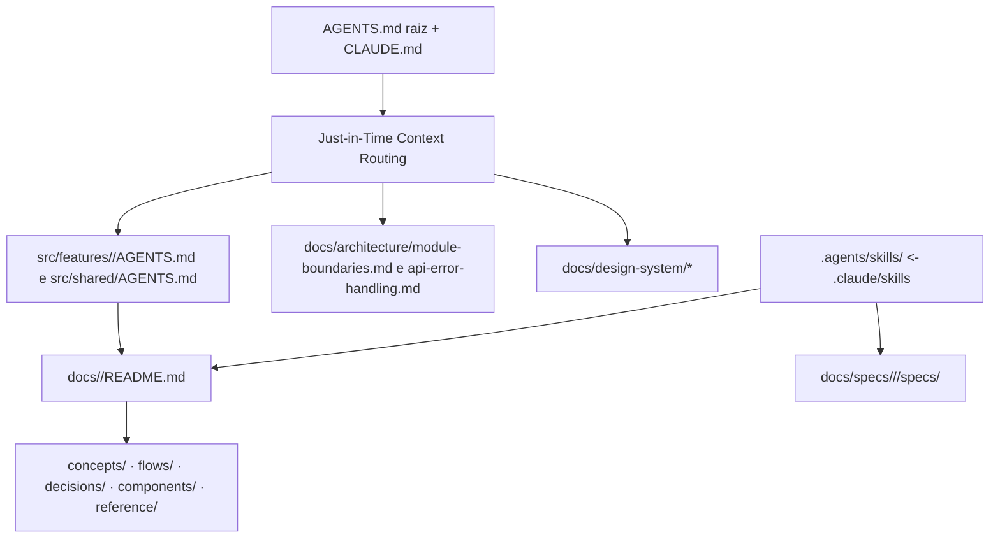

# Design — Documentação Modular, `AGENTS.md` por Módulo e Skills do Frontend

## Arquitetura de Governança

A arquitetura de contexto do repositório passa a operar em **três camadas complementares**, espelhando o padrão consolidado do `personal-finance-backend` e adaptado às especificidades de um frontend React + TypeScript:



### Separação de Autoridades

1. **Contratos de mudança (`docs/specs/<modulo>/<feature>/specs/`):** governados pela skill `spec-driven-development`; definem requisitos, design técnico, tarefas e decisões locais antes e durante a implementação.
2. **Documentação viva modular (`docs/<modulo>/`):** governada pela skill `modular-documentation`; descreve o comportamento **atual** confirmado no código e nos contratos backend consumidos.
3. **Instruções locais (`src/features/<modulo>/AGENTS.md` e `src/shared/AGENTS.md`):** ponto de entrada obrigatório para agentes antes de planejar, editar ou revisar código daquele módulo; aponta para `docs/<modulo>/` e resume invariantes e limites que não podem ser violados.

## Estrutura Modular A1 (`docs/<modulo>/`)

Cada módulo de domínio em `docs/<modulo>/` adota a estrutura plana e uniforme:

```text
docs/<modulo>/
├── README.md          # Índice do módulo: escopo, mapa de leitura, cobertura e pendências
├── concepts/          # Entidades de UI/domínio, modelos mentais, estados e papéis
├── flows/             # Fluxos ponta a ponta, rotas, estados (loading/empty/error) e tabela de API
├── decisions/         # ADRs atômicos (Problema, Decisão, Consequência, supersedes)
├── components/        # Árvore por Atomic Design, dono de estado, shared e cross-feature
└── reference/         # Matriz consolidada de endpoints, constantes, rotas, chaves de query e gaps
```

### Regras de Frontmatter Canônico

```yaml
---
area: <modulo | architecture | design-system | documentation>
type: index | concept | flow | decision | component | reference
status: draft | current | historical | deprecated
last_reviewed: YYYY-MM-DD   # obrigatório em índices e referências vivas
decision-id: DEC-NNN        # obrigatório quando type: decision
decision-status: accepted | proposed | superseded | deprecated
supersedes: <link relativo> # quando substitui decisão anterior
superseded-by: <link relativo>
related:
  - <link relativo válido>
---
```

Para specs em `docs/specs/**`, os tipos permanecem `spec-requirements | spec-design | spec-tasks | spec-decisions` e os status válidos incluem `draft | approved | current | historical | deprecated`.

### Referências Cross-Repo Portáveis

Como o repositório pode ser aberto em diferentes diretórios ou worktrees isolados (ex.: Orca), links relativos com `../../../../../../personal-finance-backend/...` quebram facilmente. Referências a documentos do backend devem usar notação canônica não-relativa:

- `` `personal-finance-backend:docs/integrations/<recurso>/<operacao>.md` ``

## Plano de Migração por Módulo

### 1. `docs/auth/`
Migrar as 9 subárvores existentes (`authenticated-shell`, `authentication/{sign-in,sign-up,oauth-google}`, `change-password`, `email-verification`, `profile`, `providers`, `sessions`) preservando integralmente o conteúdo técnico e todas as decisões:
- `README.md`: mapa completo de autenticação, sessões, verificação de e-mail, providers, alteração de senha, perfil/avatar, shell autenticado e nota explícita de que `DashboardPage` e `users/profile` hoje residem em `src/features/auth`.
- `concepts/`: `session-and-cookie-model.md`, `verification-and-provider-states.md`.
- `flows/`: `sign-in.md`, `sign-up.md`, `oauth-google.md`, `email-verification.md`, `session-lifecycle.md`, `link-providers.md`, `change-password.md`, `manage-profile.md`, `authenticated-shell-routing.md`.
- `decisions/`: migrar todas as 13 decisões existentes mantendo `decision-id`, `decision-status` e links `related` atualizados.
- `components/`: consolidar/migrar os 9 documentos de componentes mantendo responsabilidade coesa por domínio funcional (`auth-forms.md`, `oauth-callbacks.md`, `verification-panels.md`, `change-password-dialog.md`, `profile-editor.md`, `security-provider-controls.md`, `session-controls.md`, `shell-and-settings.md`).
- `reference/`: `api-and-routes.md` (matriz completa de rotas frontend, endpoints `/auth/*` e `/users/*`, query keys e códigos de erro).

### 2. `docs/accounts/`
Migrar `account-templates/documentacao/*` e completar o módulo inteiro com base no código atual:
- `README.md`
- `concepts/`: `account-and-template-model.md`, `balance-and-period-summary.md`
- `flows/`: `list-and-filter-accounts.md`, `create-and-update-account.md`, `account-detail-and-summary.md`, `archive-and-delete-account.md`
- `decisions/`: migrar as 3 decisões existentes (`account-template-is-the-visual-source.md`, `create-starts-with-identity.md`, `account-detail-summary-is-lazy.md`) e registrar decisões vigentes de `initialBalanceCents` e filtro de período.
- `components/`: `account-components.md` (cobrindo `AccountsPage`, `AccountDetailSheet`, `AccountFormSheet`, `AccountIdentity`, catálogo de templates e API pública em `index.ts`).
- `reference/`: `api-and-contracts.md`

### 3. `docs/categories/`
Criar documentação viva completa do módulo (hoje inexistente):
- `README.md`
- `concepts/`: `category-model-and-ownership.md`
- `flows/`: `list-and-filter-categories.md`, `manage-category-lifecycle.md` (create, edit, archive, unarchive, delete e delete-with-merge)
- `decisions/`: `system-categories-are-immutable.md`, `delete-with-merge-preserves-history.md`, `responsive-list-and-metadata-catalog.md`
- `components/`: `category-components.md`
- `reference/`: `api-and-contracts.md`

### 4. `docs/transactions/`
Migrar `screen/documentacao/*` e `attachments/documentacao/*` (adicionando frontmatter completo e tabela backend faltante) e completar o núcleo do módulo:
- `README.md`
- `concepts/`: `transaction-model-and-types.md` (`INCOME`, `EXPENSE`, `TRANSFER`, `ADJUSTMENT`, `PENDING`/`EFFECTIVE`, `amountCents > 0`, `DateOnly`), `transaction-attachments-model.md`
- `flows/`: `list-filter-and-kpis.md`, `dashboard-pending-navigation.md`, `create-edit-and-transfer.md`, `confirm-and-delete-transaction.md`, `manage-attachments.md`
- `decisions/`: migrar as 4 decisões existentes (`pending-deep-link-date-range.md`, `pending-range-includes-future.md`, `lazy-attachment-fetching-and-cache.md`, `dual-reordering-drag-and-accessible-menu.md`) com frontmatter completo + registrar `url-driven-filters-and-dateonly.md` e `transfer-cannot-be-deleted.md`.
- `components/`: `transaction-screen-components.md`, `attachment-gallery-and-viewer.md`
- `reference/`: `api-and-contracts.md`

## Evolução das Skills e Diretórios de Agentes

1. **`.agents/skills/modular-documentation/`** (substituindo `platform-feature-documentation`):
   - `SKILL.md` conciso e imperativo cobrindo `docs/<modulo>/`, `docs/README.md`, `docs/architecture/module-boundaries.md` e `src/features/<modulo>/AGENTS.md`.
   - `agents/openai.yaml` atualizado.
   - `references/`: `frontmatter-spec.md`, `module-index-template.md`, `module-agents-template.md`, `concept-template.md`, `flow-template.md`, `decision-template.md`, `component-template.md`.
2. **`.agents/skills/spec-driven-development/`**:
   - Reescrito para o domínio frontend (removendo `docs/database/schema.md`, migrations, ORM, outbox, swagger; adicionando UI/Design System, `apiErrorCodes.ts`, URL state, acessibilidade, fronteiras de feature e atualização de `docs/<modulo>/` + `AGENTS.md`).
3. **`.agents/skills/danfy-api-error-handling/`**:
   - Atualizar referências a `personal-finance-backend:docs/integrations/...`.
4. **`.claude/skills`**:
   - Remover diretório com symlinks parciais e criar symlink único `.claude/skills -> ../.agents/skills`.
5. **`.github/`**:
   - Remover `.github/copilot-instructions.md`, `.github/instructions/` e `.github/skills/` (Copilot descontinuado neste repositório).

## Estratégia de Validação

1. Script de auditoria verificando:
   - Ausência total de pastas `documentacao/` em `docs/`;
   - 100% dos arquivos em `docs/<modulo>/**/*.md` com frontmatter YAML válido;
   - Zero links relativos quebrados em `docs/**/*.md`, `AGENTS.md` e `src/**/AGENTS.md`;
   - Zero referências quebradas a `../../../../../../personal-finance-backend/`;
   - Cobertura de endpoints de `src/features/*/api/*` nos documentos de `docs/<modulo>/`;
   - Integridade do symlink `.claude/skills -> ../.agents/skills`.
2. Execução de `npm run lint`, `npm test` e `npm run build` para confirmar zero impacto no código-fonte.
