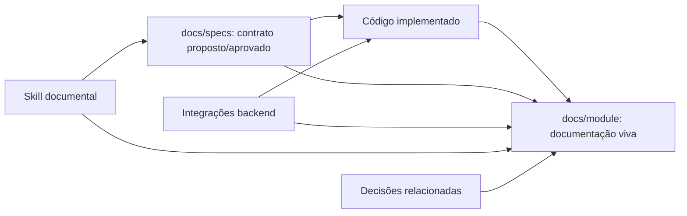

# Design — padrão documental de features da plataforma

## Visão geral

O desenho usa três camadas com autoridades distintas:



- A spec diz o que pode ser implementado e como o trabalho será executado.
- Código e contratos backend dizem o que existe atualmente.
- Documentação viva explica estrutura, fluxo, consumo e decisões atuais.
- A skill torna o processo repetível e impede criação de caminhos/documentos
  incompatíveis.

## Skill `platform-feature-documentation`

### Estrutura

```text
.agents/skills/platform-feature-documentation/
├── SKILL.md
├── agents/
│   └── openai.yaml
└── references/
    └── documentation-files.md
```

Não criar README, changelog, assets ou scripts sem necessidade comprovada.

### Criação

Depois da aprovação, usar o `init_skill.py` da skill global `skill-creator`,
passando o diretório `.agents/skills` e interfaces determinísticas para
`display_name`, `short_description` e `default_prompt`. Em seguida:

1. substituir o template pelo workflow do projeto;
2. manter `SKILL.md` curto e imperativo;
3. colocar os contratos detalhados das três árvores documentais em
   `references/documentation-files.md`;
4. gerar/validar `agents/openai.yaml`;
5. executar `quick_validate.py`.

### Workflow interno da skill

```text
Discover scope
  -> classify module/feature/subfeature
  -> read AGENTS + spec + current docs
  -> inspect relevant source and backend integration
  -> build evidence inventory
  -> update documents in decisions/flow/components
  -> reconcile contradictions and statuses
  -> validate paths, links and coverage
  -> report changed coverage and known gaps
```

A skill não implementa comportamento de produto por conta própria e não marca
spec como aprovada.

## Modelo documental

### Identidade e status

Os arquivos das três árvores de uma feature compartilham `area`, `feature`,
`subfeature` opcional, `status` e links relacionados. Status possui semântica:

- `proposed`: baseado em spec ainda não implementada;
- `current`: confirmado pelo código/contrato atual;
- `historical`: preservado para contexto, não normativo;
- `deprecated`: não deve orientar novas mudanças.

### Autoridade e reconciliação

Ao documentar:

1. comparar spec, código, docs backend e docs existentes;
2. classificar divergência como stale doc, código fora da spec, contrato externo
   divergente ou proposta não implementada;
3. não corrigir código fora do escopo de documentação;
4. registrar gap e fonte em um documento de `decisions/` ou seção de gaps;
5. somente marcar `current` com evidência no código/integração.

### Decisões conectadas

IDs são locais à feature. Relações cross-feature apontam ao arquivo da decisão,
por exemplo:

```text
related: ../../../sessions/documentacao/decisions/session-cookie-lifecycle.md
```

Uma decisão aceita pode ser alterada somente por outra entrada que a marque como
`superseded`. Fluxos e componentes devem referenciar a decisão vigente quando o
comportamento não for óbvio.

## Documentação inicial de auth

### Authentication/sign-in

Documentar:

- formulário, schema deliberadamente simples e erro de credencial;
- `POST /auth/sign-in` e sincronização por `GET /users/me`;
- cookies HttpOnly, interceptor/refresh e redirect pós-auth;
- componentes próprios e shared.

### Authentication/sign-up

Documentar:

- campos, política central, confirmação local e DTO sem confirmação;
- `POST /auth/sign-up`, `GET /users/me` e pending email verification;
- componentes de senha e feedback.

### Authentication/oauth-google

Documentar:

- redirects `GET /auth/google` e callback backend;
- frontend `/auth/callback` sem token em query;
- finalização por `GET /users/me`.

### Email verification

Documentar confirmação pública, reenvio autenticado, cooldown, limite diário,
status de usuário, rotas frontend e componentes específicos.

### Providers

Documentar providers retornados por `GET /users/me`, vínculo `EMAIL`, vínculo
Google, callback/mensagens entre janelas, formulários e erros.

### Sessions

Documentar listagem, revogação individual, logout, refresh centralizado,
sincronização entre abas e componentes de sessão.

### Profile

Documentar perfil, username/availability, avatar e dependência dos endpoints do
recurso `users`, deixando explícito que o código hoje reside na feature auth.

### Authenticated shell

Documentar rotas públicas/privadas, bootstrap de auth, sidebar/settings,
controle por status de verificação e composição das páginas.

### Change password

Começar em estado `proposed` com a spec aprovada; tornar `current` somente após
testes e implementação. Documentar provider gate, diálogo, política, endpoint,
erros temporários, retry e encerramento de todas as sessões.

## Matriz mínima de consumo backend de auth

A implementação documental deve reconciliar, no mínimo:

| Área | Operações |
| --- | --- |
| Sign-in/up | `POST /auth/sign-in`, `POST /auth/sign-up`, `GET /users/me` |
| OAuth | `GET /auth/google`, callback backend, `GET /users/me` |
| Refresh/logout | `POST /auth/refresh`, `POST /auth/logout` |
| Verificação | `POST /auth/email-verification/confirm`, `POST /auth/email-verification/resend` |
| Providers | `POST /auth/providers/link/email`, `GET /auth/providers/link/google`, callback |
| Sessões | `GET /auth/sessions`, `DELETE /auth/sessions/:jti` |
| Perfil | `GET/PATCH /users/me`, username/availability e avatar conforme integração atual |
| Senha | `POST /auth/password/change` |

Nenhum documento deve afirmar uso de Bearer/localStorage ou tokens em query.

## Migração de specs legadas

### Estratégia

1. Inventariar links de entrada e saída.
2. Criar o destino normalizado com quatro arquivos.
3. Separar conteúdo sem mudar requisitos históricos.
4. Adicionar frontmatter e status real.
5. Marcar o que foi reconstruído a partir de uma spec monolítica.
6. Atualizar links.
7. Remover origem somente depois que `rg` não encontrar referências válidas ao
   caminho antigo.

### Regras de reconstrução

- `requirements.md`: somente comportamentos/aceites já escritos ou observáveis.
- `design.md`: arquitetura e integração do documento original, corrigindo links
  técnicos comprovadamente obsoletos com nota histórica.
- `tasks.md`: preservar tarefas/status; se inexistente, registrar apenas tarefas
  verificáveis e marcar reconstruído.
- `decisions.md` da spec: extrair trade-offs explícitos; não transformar toda escolha de
  classe em ADR.

Transfer já atende à estrutura e não deve sofrer churn meramente cosmético.

## Validação

### Skill

- `quick_validate.py` para nome/frontmatter.
- Conferência de `agents/openai.yaml` contra `SKILL.md`.

### Documentação

- `rg --files` para cobertura esperada.
- busca por caminhos legados e referências quebradas.
- validação dos links relativos por script simples somente se necessário; se um
  script reutilizável for criado, ele deve pertencer à skill e ser testado.
- busca de contratos sabidamente obsoletos (`/auth/me`, Bearer/token em query)
  nos documentos marcados `current`.
- revisão manual da matriz de endpoints contra backend e source atual.

### Código

Se a implementação alterar `AGENTS.md` e docs apenas, lint/build não validam
Markdown, mas devem ser executados caso qualquer TypeScript/configuração seja
tocada. A feature auth executará seus próprios checks.

## Segurança

- Exemplos nunca contêm credenciais reais, tokens, cookies, identifiers ou
  payloads sensíveis.
- Documentos de senha descrevem campos e regras, não valores.
- Cópia de mensagens brutas do backend não vira UX normativa.
- Links para backend podem apontar a documentação local; não duplicar detalhes
  operacionais sem relevância para o frontend.

## Riscos e mitigação

- Specs antigas misturam estado proposto e implementado: usar status explícito
  e evidência, sem aprovação retroativa.
- Documentação auth antiga contém contratos obsoletos: construir docs vivas a
  partir de código/backend atuais e preservar legado como histórico.
- Excesso de fragmentação: subfeature somente com fluxo/decisão independente.
- Documentação virar espelho de código: focar responsabilidades e relações.
- Skill verbosa consumir contexto: detalhes ficam em uma única referência.
