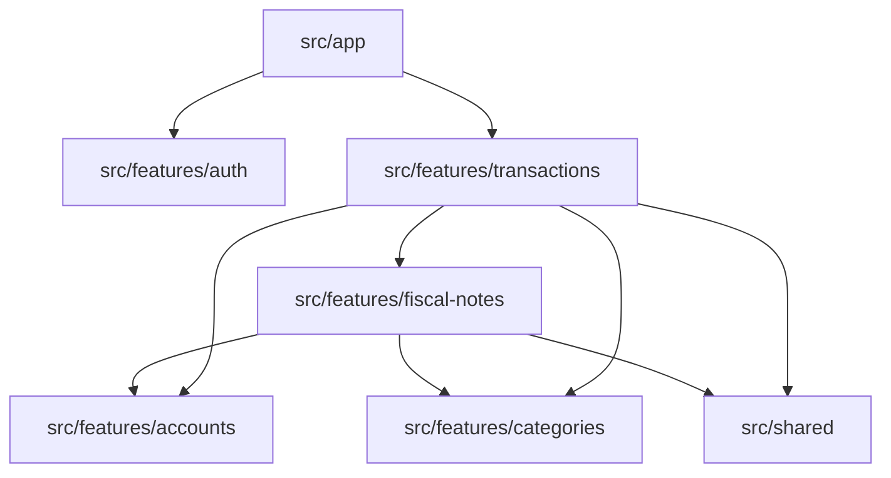
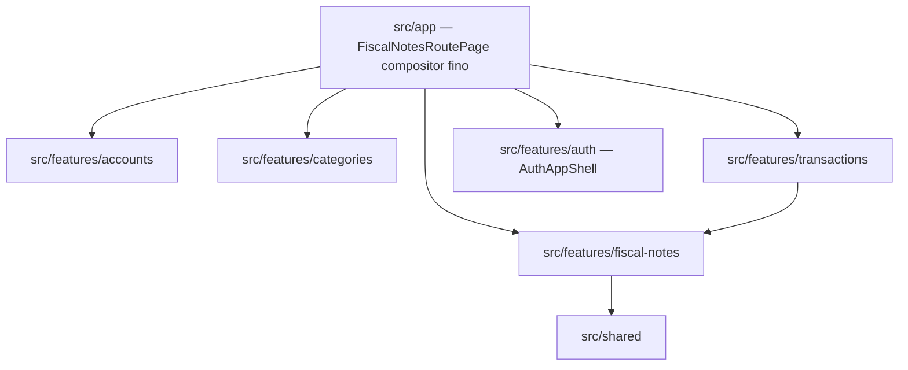

# Design — Leitor de NFC-e (SEFAZ-CE) e Lista de Compras

## 1. Arquitetura de Módulo e Fronteiras (Zero Ciclos)

A feature será implementada em um **módulo dedicado** `src/features/fiscal-notes/`, espelhando o módulo `fiscal-notes` do backend e preparando a base para futuras visões globais de lista de compras/mercado.



### Regra de Aciclicidade (`transactions -> fiscal-notes`, nunca o inverso)

- `src/features/fiscal-notes/` **NUNCA** importa de `src/features/transactions/`.
- Para suportar **anexos em staging no fluxo de Import** sem criar ciclo `fiscal-notes -> transactions`, `FiscalNoteReaderSheet` recebe slots/callbacks injetados por `TransactionsPage`:
  - `renderAttachmentsField?: (props: { disabled: boolean; isUploading: boolean }) => ReactNode`
  - `onAfterImport?: (transactionId: string) => Promise<void>` (onde `TransactionsPage` faz o upload dos anexos em staging via `uploadTransactionAttachments` e limpa o estado local)
  - `onOpenExistingTransaction?: (transactionId: string) => void` (onde `TransactionsPage` busca a transação via `GET /transactions/:id` e abre `TransactionDetailsSheet`)
  - `onInvalidateExternalQueries?: () => void` (ou `fiscal-notes` invalida `['transactions']` e `['accounts']` usando chaves/constantes públicas sem importar internals — preferencialmente via `onImportSuccess` / `onLinkSuccess` / `onUnlinkSuccess` + invalidação interna de `FISCAL_NOTE_QUERY_KEYS` e `ACCOUNT_QUERY_KEYS` / `['transactions']`).
- `src/features/auth/` (`MobileQuickActions` e `AuthAppShell`) não importa nada de `fiscal-notes`: usa apenas a rota constante `AUTH_QUICK_ACTION_ROUTES.fiscalNote`.
- **API pública (`src/features/fiscal-notes/index.ts`):**
  - Componentes: `FiscalNoteBadge`, `FiscalNoteReaderSheet`, `FiscalNoteSummaryCard`, `FiscalNoteDetailsSheet`, `FiscalNoteUnlinkDialog`, `FiscalNoteItemsList`.
  - Tipos públicos: `FiscalNote`, `FiscalNoteItem`, `FiscalNotePayment`, `FiscalNotePreviewResponse`, `FiscalNoteReaderSheetState`, `FiscalNoteLinkTarget`.
  - Constantes: `FISCAL_NOTE_QUERY_KEYS`.

---

## 2. Rotas Frontend e Parâmetros de URL

Nenhuma nova rota de página é criada na V1. O fluxo integra-se à rota existente `/transactions`:

| Recurso | Local | Mudança |
| --- | --- | --- |
| Quick Action Route | `src/features/auth/constants/auth.constants.ts` | Adicionar `AUTH_QUICK_ACTION_ROUTES.fiscalNote = '/transactions?view=EXPENSE&create=FISCAL_NOTE'` |
| Quick Action UI | `src/features/auth/components/organisms/MobileQuickActions.tsx` + `AuthAppShell.tsx` | Novo botão **"Ler NFC-e"** (`QrCode`, `tone="brand"`, `col-span-2 col-start-3 row-start-2`, ocupando o slot central livre do arco) disparando `onImportFiscalNote` |
| Create Intent URL | `src/features/transactions/utils/transactionUrl.utils.ts` | Ampliar `TransactionCreateIntent` com `'FISCAL_NOTE'` em `parseTransactionCreateIntent` |
| Orquestração de Página | `src/features/transactions/components/pages/TransactionsPage.tsx` | Ao receber `createIntent === 'FISCAL_NOTE'`, abrir `FiscalNoteReaderSheet` em modo `import` e remover `create` da URL com `{ replace: true }` |

---

## 3. Dependência de QR Code e Self-Host do WASM

- **Dependência:** adicionar `barcode-detector` (`^3.2.5`, MIT — inclui `zxing-wasm`).
- **Self-host do `.wasm` (sem depender de CDN jsDelivr em produção):**
  - Criar utilitário `src/features/fiscal-notes/utils/qrBarcodeDetector.utils.ts`:
    - Importa `BarcodeDetector` e `prepareZXingModule` de `barcode-detector/ponyfill`;
    - Resolve a URL local do binário `zxing_reader.wasm` via `import zxingReaderWasmUrl from 'zxing-wasm/reader/zxing_reader.wasm?url'` (ou cópia/resolução verificada no build Vite 8), configurando `prepareZXingModule({ overrides: { locateFile: () => zxingReaderWasmUrl } })` uma única vez (lazy singleton);
    - Expõe `createQrBarcodeDetector()` (instância com `{ formats: ['qr_code'] }`) e `decodeQrCodeFromImageFile(file: File): Promise<string | null>` (usando `createImageBitmap(file)` ou `HTMLImageElement` como fallback).
  - *Nota de verificação na tarefa de implementação:* validar `npm run build` confirmando que o `.wasm` é emitido em `dist/assets/` sem requisição externa em runtime.

### Hook `useQrCodeScanner` (`src/features/fiscal-notes/hooks/useQrCodeScanner.ts`)

Responsabilidades:
- Gerencia estado explícito via discriminated union:
  `status: 'idle' | 'requesting' | 'scanning' | 'paused' | 'error'`
  `errorReason: 'insecure-context' | 'unsupported' | 'permission-denied' | 'not-found' | 'in-use' | 'unknown' | null`
- Mantém `videoRef`, `devices: MediaDeviceInfo[]`, `selectedDeviceId: string | null`, `torchSupported: boolean`, `torchEnabled: boolean`.
- `useEffect` com flag `cancelled` (seguro para React 19 Strict Mode): se desmontar durante `getUserMedia`, para todas as tracks imediatamente.
- Loop de leitura com `window.setInterval` a cada `250ms` (verificando `video.readyState >= HTMLMediaElement.HAVE_ENOUGH_DATA` e guard de concorrência `isDetectingRef`) para evitar empilhamento de promises WASM.
- Ao detectar 1º `rawValue` não vazio: para/pausa o loop imediatamente (`single-shot lock`) e invoca `onDetect(rawValue)`.
- Suporta `restart()`, `switchCamera()`, `toggleTorch()`.
- Aceita injeção opcional de `detectorFactory` / `mediaDevices` nos parâmetros para testabilidade unitária limpa no Vitest.

---

## 4. Estrutura de Arquivos (`src/features/fiscal-notes/`)

```text
src/features/fiscal-notes/
├── AGENTS.md
├── index.ts
├── api/
│   ├── fiscal-notes.api.ts          # funções puras Axios (preview, import, link, getByTransaction, unlink)
│   ├── queries.ts                   # useTransactionFiscalNote
│   └── mutations.ts                 # usePreviewFiscalNote, useImportFiscalNote, useLinkFiscalNote, useUnlinkFiscalNote
├── constants/
│   └── fiscal-notes.constants.ts    # endpoints, query keys, limites, UF 23, modelo 65, timeouts/throttle
├── hooks/
│   ├── useQrCodeScanner.ts          # câmera WebRTC + barcode-detector + torch/switch/cleanup
│   └── useRetryCountdown.ts         # contador regressivo a partir de retryAfterSeconds (429/503)
├── schemas/
│   ├── fiscalNoteInput.schema.ts    # validação Zod fail-fast da entrada (URL, payload p, chave 44d, mod-11)
│   └── fiscalNoteImport.schema.ts   # validação Zod da Etapa 2 de importação (accountId, categoryId, amountCents >= 1, date, description, status)
├── types/
│   ├── fiscal-note.types.ts         # contratos de domínio/API alinhados aos DTOs Swagger
│   └── fiscal-note-ui.types.ts      # estados de sheets, modos de captura, divergências, filtros de itens
├── utils/
│   ├── fiscalNoteInput.utils.ts     # parse local (URL/p/44d), mod-11, formatação em blocos de 4, máscara CNPJ/chave
│   ├── fiscalNoteFormat.utils.ts    # formatação pt-BR de quantity/unitPrice (até 4 casas), datas, divergências
│   └── qrBarcodeDetector.utils.ts   # lazy singleton BarcodeDetector (zxing-wasm self-hosted) + decode de imagem
└── components/
    ├── atoms/
    │   ├── FiscalNoteBadge.tsx              # badge compacto/completo para listagem de transactions
    │   └── FiscalNoteItemRow.tsx            # linha individual read-only de item da lista de compras
    ├── molecules/
    │   ├── FiscalNoteAccessKeyField.tsx     # input manual (URL/chave 44d) com visualização agrupada + feedback local
    │   ├── FiscalNoteDivergenceAlert.tsx    # alerta comparativo (Transação vs Nota) no fluxo de vínculo
    │   ├── FiscalNoteDuplicateBanner.tsx    # banner proativo de nota já importada + CTA "Ver despesa existente"
    │   ├── FiscalNoteImageUploadPane.tsx    # seletor/dropzone de foto/print da galeria para decodificar QR
    │   ├── FiscalNoteMetadataBlock.tsx      # emitente, CNPJ, endereço, nº/série, emissão, protocolo e chave copiável
    │   ├── FiscalNotePaymentsList.tsx       # lista de formas de pagamento (informativo)
    │   └── FiscalNoteTotalsCard.tsx         # bruto, desconto, a pagar, tributos e troco (omitido se null)
    └── organisms/
        ├── FiscalNoteQrScannerPane.tsx      # viewfinder de câmera com guia, torch, troca de câmera e fallbacks
        ├── FiscalNoteItemsList.tsx          # lista reutilizável com busca em tempo real + empty state de busca (preparada para tela futura)
        ├── FiscalNoteSummaryCard.tsx        # card resumo para TransactionDetailsSheet (prévia 3 itens + ações)
        ├── FiscalNoteDetailsSheet.tsx       # sheet dedicado da nota completa / lista de compras
        ├── FiscalNoteUnlinkDialog.tsx       # AlertDialog de confirmação de desvínculo isolado
        └── FiscalNoteReaderSheet.tsx        # sheet responsivo multi-etapas (Captura → Preview → Import/Link)
```

### Auditoria Atomic Design

- **`atoms` (`FiscalNoteBadge`, `FiscalNoteItemRow`):** zero hooks de API, zero estado global, zero imports de componentes customizados superiores; apenas HTML/Lucide/tokens Danfy.
- **`molecules`:** compõem átomos e primitivos `src/shared/components/ui/*`; recebem callbacks via props, sem chamar TanStack Query ou Axios.
- **`organisms`:** orquestram hooks (`useQrCodeScanner`, `usePreviewFiscalNote`, `useImportFiscalNote`, `useLinkFiscalNote`, `useTransactionFiscalNote`, `useUnlinkFiscalNote`, `useRetryCountdown`), formulários RHF+Zod e composição de moléculas.

---

## 5. Contratos de API e Donos de Estado

### 5.1 Endpoints e Contratos TypeScript

Baseados diretamente nos DTOs Swagger de `personal-finance-backend` (PR `#146`):

| Operação | Método & Rota | Request DTO | Response DTO |
| --- | --- | --- | --- |
| Preview | `POST /fiscal-notes/preview` | `{ input: string }` | `FiscalNotePreviewResponse` (`object: 'fiscal_note.preview'`) |
| Import | `POST /fiscal-notes/import` | `ImportFiscalNoteDto` | `ImportFiscalNoteResponse` (`object: 'fiscal_note.import'`) |
| Link | `POST /transactions/:id/fiscal-note` | `{ input: string }` | `FiscalNoteResponse` (`object: 'fiscal_note.item'`) |
| Get | `GET /transactions/:id/fiscal-note` | — | `FiscalNoteResponse` (`object: 'fiscal_note.item'`) |
| Unlink | `DELETE /transactions/:id/fiscal-note` | — | `204 No Content` |

**Adição em `src/features/transactions/types/transaction.types.ts`:**
- Adicionar `hasFiscalNote?: boolean` na interface `Transaction` (opcional no tipo para retrocompatibilidade com fixtures/mocks antigos, tratado com `Boolean(transaction.hasFiscalNote)`).

### 5.2 TanStack Query — Query Keys, Cache e Invalidações

```ts
export const FISCAL_NOTE_QUERY_KEYS = {
  all: ['fiscal-notes'] as const,
  byTransaction: (transactionId: string) =>
    ['fiscal-notes', 'transaction', transactionId] as const,
} as const
```

| Query / Mutation | `staleTime` / Invalidação |
| --- | --- |
| `useTransactionFiscalNote(transactionId, { enabled })` | `enabled: Boolean(transactionId && hasFiscalNote)`; `staleTime: 5 * 60 * 1000` (nota é imutável na V1); `retry: false` em `404` |
| `usePreviewFiscalNote()` | Mutation (somente leitura no servidor); sem invalidação; `retry: false` |
| `useImportFiscalNote()` | `onSuccess`: preenche `setQueryData(FISCAL_NOTE_QUERY_KEYS.byTransaction(res.transaction.id), res.fiscalNote)`, invalida `['transactions']` e `['accounts']` |
| `useLinkFiscalNote()` | `onSuccess`: preenche `setQueryData(FISCAL_NOTE_QUERY_KEYS.byTransaction(transactionId), fiscalNote)` e invalida `['transactions']` |
| `useUnlinkFiscalNote()` | `onSuccess`: `removeQueries(FISCAL_NOTE_QUERY_KEYS.byTransaction(transactionId))` e invalida `['transactions']` |

### 5.3 Fluxo de Recuperação de Duplicata (`Ver despesa existente`)

Em `TransactionsPage`:
- Novo estado `pendingDuplicateTransactionId: string | null` (ou chamada imperativa `queryClient.fetchQuery` usando `TRANSACTION_API_ENDPOINTS.transactions + '/' + id`).
- Quando `FiscalNoteReaderSheet` invoca `onOpenExistingTransaction(existingTransactionId)`:
  1. Busca `GET /transactions/:id` (com feedback de loading no botão do banner);
  2. Fecha `FiscalNoteReaderSheet`;
  3. Abre `TransactionDetailsSheet` com a transação retornada (funcionando inclusive se ela for de outro mês ou página não carregada na listagem).
  4. Se a busca falhar (ex.: transação foi excluída em outra aba), exibe toast de erro via `showApiErrorToast(error, 'transactions.detail')`.

### 5.4 Fluxo de Staging de Anexos no Import

Em `TransactionsPage`:
- Mantém estado de `importStagedAttachments: StagedTransactionAttachment[]` (limpo ao abrir/fechar `FiscalNoteReaderSheet`).
- Injeta `TransactionStagedAttachmentsField` no slot `renderAttachmentsField` do `FiscalNoteReaderSheet`.
- No callback `onAfterImport(transactionId)`:
  - Se `importStagedAttachments.length > 0`, chama `uploadTransactionAttachments(transactionId, files)` e invalida `TRANSACTION_QUERY_KEYS.transactions` + `TRANSACTION_ATTACHMENT_QUERY_KEYS.list(transactionId)`;
  - Se o upload falhar, **não reabre o erro como falha de importação**: fecha o sheet e mostra `toast` explicando que a despesa e a NFC-e foram salvas, mas houve erro ao enviar os anexos (evitando duplicata de despesa, idêntico ao `TransactionFormSheet`).

---

## 6. Inventário de Erros (`src/shared/errors/`)

### 6.1 Novos `ApiErrorContext` (`apiError.types.ts`)

- `'fiscal-notes.preview'`
- `'fiscal-notes.import'`
- `'fiscal-notes.link'`
- `'fiscal-notes.detail'`
- `'fiscal-notes.unlink'`

### 6.2 Novos `API_ERROR_CODES` (`apiErrorCodes.ts`) e Mapeamento (`resolveApiError.ts`)

| Código Backend | HTTP | Superfície UX | Copy & Recuperação (pt-BR) |
| --- | --- | --- | --- |
| `FISCAL_NOTE_INVALID_INPUT` | `400` | `ApiErrorAlert` / erro de campo | "Código da NFC-e inválido" — confira se o QR Code foi lido por completo ou se os 44 dígitos estão corretos (`recovery: 'correct-fields'`). |
| `INVALID_FISCAL_NOTE` | `400` | `ApiErrorAlert` | "Não foi possível validar os dados desta nota fiscal." (`recovery: 'none'`). |
| `FISCAL_NOTE_NOT_FOUND` | `404` | Estado vazio / toast | "Nenhuma nota fiscal vinculada a esta despesa." (`recovery: 'none'`). |
| `FISCAL_NOTE_SEFAZ_NOT_FOUND` | `404` | `ApiErrorAlert` | "Nota fiscal não encontrada na SEFAZ-CE" — verifique se a nota já foi autorizada ou se a chave está correta (`recovery: 'correct-fields'`). |
| `FISCAL_NOTE_ALREADY_IMPORTED` | `409` | `FiscalNoteDuplicateBanner` | "Esta nota fiscal já foi importada" — exibe CTA *"Ver despesa existente"* lendo `details.existingTransactionId` (`recovery: 'none'`). |
| `TRANSACTION_ALREADY_HAS_FISCAL_NOTE` | `409` | `ApiErrorAlert` | "Esta despesa já possui uma nota fiscal vinculada" — desvincule a nota atual antes de anexar outra (`recovery: 'none'`). |
| `TRANSACTION_TYPE_DOES_NOT_SUPPORT_FISCAL_NOTE` | `409` | `ApiErrorAlert` | No contexto de vínculo: "Apenas despesas aceitam NFC-e". No contexto de edição/confirmação de transação: "Desvincule a nota fiscal antes de alterar o tipo desta transação." (`recovery: 'none'`). |
| `FISCAL_NOTE_UNSUPPORTED_UF` | `422` | `ApiErrorAlert` | "Estado ainda não suportado" — nesta versão, a Danfy lê apenas NFC-e emitidas no Ceará (UF 23) (`recovery: 'none'`). |
| `FISCAL_NOTE_HOMOLOGATION_NOT_ALLOWED` | `422` | `ApiErrorAlert` | "Nota de teste não permitida" — apenas notas fiscais emitidas em ambiente de produção podem ser importadas (`recovery: 'none'`). |
| `FISCAL_NOTE_CANCELLED_OR_DENIED` | `422` | `ApiErrorAlert` | "Nota fiscal cancelada ou denegada" — a SEFAZ informou que este documento não é mais válido (`recovery: 'none'`). |
| `FISCAL_NOTE_RATE_LIMIT_EXCEEDED` | `429` | `ApiErrorAlert` + countdown | "Muitas consultas em sequência" — aguarde `retryAfterSeconds` segundos para consultar outra nota (`recovery: 'retry'`). |
| `FISCAL_NOTE_PARSE_FAILED` | `502` | `ApiErrorAlert` | "Não conseguimos ler o formato retornado pela SEFAZ-CE" — tente novamente mais tarde (`recovery: 'retry'`). |
| `FISCAL_NOTE_RESPONSE_TOO_LARGE` | `502` | `ApiErrorAlert` | "Resposta da SEFAZ excedeu o limite suportado" (`recovery: 'retry'`). |
| `SEFAZ_TEMPORARILY_UNAVAILABLE` | `503` | `ApiErrorAlert` + countdown | "SEFAZ-CE temporariamente indisponível" — aguarde `retryAfterSeconds` segundos e tente novamente (`recovery: 'retry'`). |
| `SEFAZ_TIMEOUT` | `504` | `ApiErrorAlert` | "A SEFAZ-CE demorou para responder" — tente novamente em instantes (`recovery: 'retry'`). |

**Helper adicional em `parseApiError.ts`:** `parseFiscalNoteConflictDetails(error: unknown): { existingTransactionId: string | null; existingFiscalNoteId: string | null } | null` (ou helper dedicado em `fiscal-notes/utils` usando `parsePlatformError(error)?.details` com type guards seguros — preferir manter `parsePlatformError` genérico em `shared` e fazer o narrowing específico de domínio em `fiscal-notes/utils/fiscalNoteError.utils.ts` para não acoplar `shared` a detalhes de um único domínio!).

---

## 7. Design System, Tokens Danfy Dark e Material 3

- **Superfícies:**
  - `FiscalNoteReaderSheet` e `FiscalNoteDetailsSheet`: `Sheet` (`side={isMobile ? 'bottom' : 'right'}`), fundo `bg-card`, bordas `border-border`, cards internos `bg-secondary` / `bg-app-panel`, respeitando DEC-007 (`sheetVariants` sem especificidade quebrada).
  - `FiscalNoteUnlinkDialog`: `AlertDialog` com ação destrutiva em `bg-destructive text-destructive-foreground`.
- **Semântica de cores:**
  - `state-expense`: botão principal de salvar despesa no `import` e valor de despesa;
  - `brand`: acento do viewfinder do leitor de QR, aba ativa e atalho no `MobileQuickActions`;
  - `state-warning`: banner de divergência no vínculo e alerta de duplicata proativa;
  - `destructive`: erros de validação/API e confirmação de desvínculo;
  - **Zero** cores hardcoded (`#...`, `rgb(...)`, `text-slate-*`, `bg-red-*`).
- **Tipografia:** Inter local; todas as quantidades, preços unitários, totais, CNPJs, chaves de acesso e datas com classe `.numeric`.
- **Acessibilidade:** `aria-live="polite"` para feedback de status do scanner e contagem regressiva de retry; labels explícitos em todos os inputs e botões de ícone; navegação por teclado nos tabs (`Tabs` de `src/shared/components/ui/tabs.tsx`).

---

## 8. Alterações em Módulos Existentes

| Arquivo | Mudança |
| --- | --- |
| `package.json` | Adicionar `barcode-detector` |
| `src/shared/errors/apiErrorCodes.ts` | Adicionar os 15 códigos de `fiscal-notes` |
| `src/shared/errors/apiError.types.ts` | Adicionar os 5 contextos `fiscal-notes.*` |
| `src/shared/errors/resolveApiError.ts` | Adicionar mensagens e recuperações pt-BR para os 15 códigos e 5 contextos |
| `src/features/auth/constants/auth.constants.ts` | Adicionar `AUTH_QUICK_ACTION_ROUTES.fiscalNote` |
| `src/features/auth/components/organisms/MobileQuickActions.tsx` + `AuthAppShell.tsx` | Adicionar botão **"Ler NFC-e"** no slot central da 2ª linha |
| `src/features/transactions/types/transaction.types.ts` | Adicionar `hasFiscalNote?: boolean` em `Transaction` |
| `src/features/transactions/utils/transactionUrl.utils.ts` | Aceitar `'FISCAL_NOTE'` em `TransactionCreateIntent` |
| `src/features/transactions/components/organisms/TransactionsTable.tsx` | Exibir `FiscalNoteBadge` quando `transaction.hasFiscalNote` e item *"Vincular NFC-e"* no menu `...` (quando `EXPENSE` e `!hasFiscalNote`) |
| `src/features/transactions/components/organisms/TransactionDetailsSheet.tsx` | Seção **Nota fiscal** (`EXPENSE`) com `FiscalNoteSummaryCard` (lazy query) / botão *"Vincular NFC-e"*, gatilhos para `FiscalNoteDetailsSheet` e `FiscalNoteUnlinkDialog` |
| `src/features/transactions/components/organisms/TransactionFormSheet.tsx` | (1) Atalho *"Importar via NFC-e"* em modo `create` + `EXPENSE`; (2) Bloqueio de troca de `type` quando `mode === 'edit'` e `transaction.hasFiscalNote === true` |
| `src/features/transactions/components/organisms/TransactionConfirmSheet.tsx` | Bloqueio de troca de `type` quando `transaction.hasFiscalNote === true` (se aplicável no formulário) |
| `src/features/transactions/components/organisms/TransactionDeleteDialog.tsx` | Aviso adicional quando `transaction.hasFiscalNote === true` |
| `src/features/transactions/components/pages/TransactionsPage.tsx` | Botão *"Ler NFC-e"* (header + menu mobile `...`), consumo de `?create=FISCAL_NOTE`, orquestração de `FiscalNoteReaderSheet` (modos `import` e `link`), `FiscalNoteDetailsSheet`, `FiscalNoteUnlinkDialog`, staging de anexos e abertura de transação duplicada via `GET /transactions/:id` |

---

## 9. Estratégia de Testes (Vitest + Testing Library)

1. **Utilitários & Schemas (Unit):**
   - `fiscalNoteInput.utils.test.ts`: parse de URL QR v2 normal, QR v2 contingência (8 campos), QR v3, payload `p` direto, chave 44d com espaços/hífens, cálculo e rejeição de DV mod-11, rejeição de modelo `55`, homologação (`2`), UF `!= 23`, entrada `> 1024` chars, formatação em blocos de 4 dígitos e máscara de CNPJ.
   - `fiscalNoteFormat.utils.test.ts`: quantidades/preços unitários com até 4 casas decimais, detecção de divergência valor/data, ocultação de troco `null`.
   - `fiscalNoteImport.schema.test.ts`: exigência de `accountId`, `categoryId` e `amountCents >= 1` (incluindo cenário de nota com `payableAmountCents === 0`).
2. **Erros (`src/shared/errors/resolveApiError.test.ts`):**
   - Cobertura dos 15 novos códigos de `fiscal-notes` e `retryAfterSeconds`.
3. **Hooks & Scanner:**
   - `useQrCodeScanner.test.ts`: mock de `mediaDevices` e detector — garante 1ª detecção dispara callback 1 vez e pausa o loop, cleanup chama `track.stop()` em desmontagem (inclusive durante promise pendente de `getUserMedia`), tratamento de `NotAllowedError` / `NotFoundError` / contexto inseguro.
   - `qrBarcodeDetector.utils.test.ts`: decodificação de arquivo de imagem com e sem QR Code.
4. **Componentes e Fluxos Críticos (Integration/UI):**
   - `FiscalNoteReaderSheet.test.tsx`: modo `import` (Etapa 1 manual → preview → Etapa 2 pré-preenchido → submit + staged attachments), duplicata proativa (`alreadyImported: true` → clique em *"Ver despesa existente"*), modo `link` com alerta de divergência, `429`/`503` com countdown de retry.
   - `FiscalNoteDetailsSheet.test.tsx`: exibição completa de itens, filtro de busca em tempo real, cópia da chave e gatilho de desvínculo.
   - Atualização dos testes existentes de `TransactionDetailsSheet.test.tsx`, `TransactionFormSheet.test.tsx`, `TransactionsTable.test.tsx` e `MobileQuickActions` (se houver).

---

## 10. Impacto Documental

Na entrega final (via skill `modular-documentation`):
- Criar documentação viva em `docs/fiscal-notes/{README.md, concepts/, flows/, decisions/, components/, reference/}` e `src/features/fiscal-notes/AGENTS.md`.
- Atualizar `docs/transactions/` (`README.md`, `concepts/transaction-model-and-types.md`, `flows/create-edit-and-transfer.md`, `flows/confirm-and-delete-transaction.md`, `components/transaction-screen-components.md`, `reference/api-and-contracts.md`) e `src/features/transactions/AGENTS.md`.
- Atualizar `docs/architecture/module-boundaries.md` (registrando o novo módulo `fiscal-notes` e sua relação acíclica com `transactions`) e `docs/README.md`.

---

## 11. Extensão — Listagem Global (`/fiscal-notes`) e Detalhe Direto (`GET /fiscal-notes/:id`)

### 11.1 Arquitetura Acíclica e Compositor Fino em `src/app/`



- `src/features/fiscal-notes/` mantém **zero** imports de `transactions`, `accounts`, `categories` ou `auth`.
- `FiscalNotesPage` (em `src/features/fiscal-notes/components/pages/FiscalNotesPage.tsx`) gerencia URL state, KPIs, busca, ordenação, filtros, tabela/cards, `FiscalNoteDetailsSheet` (lazy via `GET /fiscal-notes/:id`) e `FiscalNoteUnlinkDialog`.
- Para a ação inline **Ler NFC-e**, `FiscalNotesPage` recebe `onImportFiscalNote` e/ou `renderReaderSheet` (ou um compositor fino em `src/app/` renderiza `FiscalNotesPage` + `FiscalNoteReaderSheet` em modo `import` conectado às contas, categorias, staging de anexos e navegação para `/transactions?openTransaction=<id>`).
- Para **Ver despesa vinculada**, `FiscalNotesPage` navega para `/transactions?openTransaction=<transactionId>`.

### 11.2 Rotas, Navegação e Parâmetros de URL

| Recurso | Local | Mudança |
| --- | --- | --- |
| Rota dedicada | `src/features/auth/constants/auth.constants.ts` + `src/app/routes/index.tsx` | Adicionar `AUTH_ROUTES.fiscalNotes = '/fiscal-notes'` |
| Navegação `AuthAppShell` | `src/features/auth/components/templates/AuthAppShell.tsx` | Sidebar desktop: item `Notas fiscais` (`NFC-e e compras`) abaixo de *Transações*; Mobile: manter 5 slots na barra inferior e inserir `Notas fiscais` no topo do sheet *Mais* |
| URL de Listagem | `src/features/fiscal-notes/utils/fiscalNoteListUrl.utils.ts` | Query params: `q`, `issuedFrom`, `issuedTo`, `issuerCnpj`, `sourceUf`, `minAmountCents`, `maxAmountCents`, `sort`, `page`, `limit` |
| Deep-link em `TransactionsPage` | `src/features/transactions/components/pages/TransactionsPage.tsx` | Ler `?openTransaction=<id>`, buscar `GET /transactions/:id`, abrir `TransactionDetailsSheet` e remover `openTransaction` com `{ replace: true }` |

### 11.3 Contratos HTTP (`GET /fiscal-notes` e `GET /fiscal-notes/:id`)

| Operação | Método & Rota | Request / Params | Response DTO |
| --- | --- | --- | --- |
| List | `GET /fiscal-notes` | `FiscalNoteListQueryParams` (`issuedFrom`, `issuedTo`, `issuerCnpj`, `sourceUf`, `minAmountCents`, `maxAmountCents`, `search`, `page`, `limit`, `sort`) | `FiscalNoteListResponse` (`object: 'fiscal_note.list'`, `data: FiscalNoteSummaryItem[]`, `meta: FiscalNoteListMeta`, `summary: FiscalNoteListSummaryTotals`) |
| Get by ID | `GET /fiscal-notes/:id` | `:id` UUID | `FiscalNoteDetail` (`object: 'fiscal_note.item'`, com `items[]` e `payments[]` ordenados por `position ASC`) |

#### Detalhamento dos Tipos e Constantes
- **`FiscalNoteListSort`** (allowlist fechada): `'issuedAt:desc' | 'issuedAt:asc' | 'payableAmountCents:desc' | 'payableAmountCents:asc' | 'createdAt:desc' | 'createdAt:asc'` (padrão `'issuedAt:desc'`).
- **Limites e Paginação:** `FISCAL_NOTE_LIST_DEFAULT_PAGE = 1`, `FISCAL_NOTE_LIST_DEFAULT_LIMIT = 20`, `FISCAL_NOTE_LIST_MAX_LIMIT = 100`, `FISCAL_NOTE_LIST_PAGE_SIZE_OPTIONS = [10, 20, 50]`, `FISCAL_NOTE_LIST_SEARCH_MAX_LENGTH = 120`.
- **Período padrão:** `issuedFrom` e `issuedTo` iniciam `null` (todo o histórico). Presets no drawer (*Este mês*, *Últimos 30 dias*, *Últimos 90 dias*, *Todo o período*) calculam strings `DateOnly` (`YYYY-MM-DD`) via `src/shared/utils/dateOnly.ts`.
- **Normalização de URL (`fiscalNoteListUrl.utils.ts`):**
  - `parseFiscalNoteListUrlState(searchParams)` valida datas (`isValidDateOnly`) descartando `issuedFrom > issuedTo`, extrai CNPJ apenas quando exatamente 14 dígitos válidos, valida `sourceUf` (2 dígitos), valida inteiros `>= 0` descartando `minAmountCents > maxAmountCents`, aplica allowlist em `sort` e normaliza `page >= 1` e `limit` (`1..100`, opções `10/20/50`, fallback `20`).
  - `buildFiscalNoteListSearchParams(state, patch)` omite valores vazios/nulos e padrões (`page === 1`, `limit === 20`, `sort === 'issuedAt:desc'`), preservando `0` em `minAmountCents`/`maxAmountCents`.

### 11.4 TanStack Query Keys e Invalidações

```ts
export const FISCAL_NOTES_QUERY_KEYS = {
  all: ['fiscal-notes'] as const,
  lists: () => ['fiscal-notes', 'list'] as const,
  list: (filters: FiscalNoteListQueryParams) =>
    ['fiscal-notes', 'list', filters] as const,
  details: () => ['fiscal-notes', 'detail'] as const,
  detail: (fiscalNoteId: string) =>
    ['fiscal-notes', 'detail', fiscalNoteId] as const,
  byTransaction: (transactionId: string) =>
    ['fiscal-notes', 'transaction', transactionId] as const,
} as const
```

| Hook / Mutation | Comportamento de Cache e Invalidação |
| --- | --- |
| `useFiscalNotesList(params, { enabled })` | `queryKey: FISCAL_NOTES_QUERY_KEYS.list(params)`, `placeholderData: keepPreviousData`, `staleTime: 30_000`, `retry < 2` |
| `useFiscalNoteById(fiscalNoteId, { enabled })` | `queryKey: FISCAL_NOTES_QUERY_KEYS.detail(id)`, `staleTime: 5 min`, sem retry em `404` / `FISCAL_NOTE_NOT_FOUND` |
| `useImportFiscalNote()` | `setQueryData(byTransaction(txId), note)` + `setQueryData(detail(note.id), note)` + invalida `FISCAL_NOTES_QUERY_KEYS.lists()`, `transactions`, `accounts`, `dashboard` |
| `useLinkFiscalNote()` | `setQueryData(byTransaction(txId), note)` + `setQueryData(detail(note.id), note)` + invalida `FISCAL_NOTES_QUERY_KEYS.lists()`, `transactions`, `transactionDetail(txId)` |
| `useUnlinkFiscalNote()` | `removeQueries(byTransaction(txId))` + invalida `FISCAL_NOTES_QUERY_KEYS.lists()`, `FISCAL_NOTES_QUERY_KEYS.details()`, `transactions`, `transactionDetail(txId)` |
| `useDeleteTransaction()` (`transactions/api/mutations.ts`) | `removeQueries(byTransaction(txId))` + invalida `FISCAL_NOTES_QUERY_KEYS.lists()` e `FISCAL_NOTES_QUERY_KEYS.details()` (via `@/features/fiscal-notes`) |

### 11.5 Contexto de Erro `'fiscal-notes.list'` (`src/shared/errors/`)

- Adicionar `'fiscal-notes.list'` em `ApiErrorContext` (`apiError.types.ts`).
- Fallback de contexto em `resolveApiError.ts`: `loadFailure('as notas fiscais')`.
- Override contextual para `400 FISCAL_NOTE_INVALID_INPUT` quando `context === 'fiscal-notes.list'`:
  - Título: `'Filtros inválidos'`
  - Descrição: `'Confira os filtros de data, valor ou CNPJ informados e tente novamente.'`
  - Recuperação: `'correct-fields'`
  - Preserva integralmente a mensagem de QR/chave nos contextos `'fiscal-notes.preview'`, `'fiscal-notes.import'` e `'fiscal-notes.link'`.

### 11.6 Composição Atomic Design para `/fiscal-notes` (Bloco B)

- **`molecules/`:**
  - `FiscalNoteKpiStrip.tsx` (cards KPI do recorte com `totalPayableAmountCents`, `totalNotes`, `totalDiscountAmountCents`, `totalTaxAmountCents`);
  - `FiscalNoteFilterChips.tsx` (chips removíveis para busca/filtros ativos + ação limpar tudo).
- **`organisms/`:**
  - `FiscalNoteFiltersSheet.tsx` (drawer/sheet com presets de data, `DateOnlyPicker`, faixa de valor `CurrencyInput`, CNPJ mascarado, `sourceUf` e validação local antes de aplicar);
  - `FiscalNoteListTable.tsx` (tabela desktop + cards mobile com `itemsCount`, ações *Ver lista de compras*, *Ver despesa vinculada* e *Desvincular*);
  - `FiscalNoteDetailsSheet.tsx` (adaptado para receber `fiscalNote` direto ou `fiscalNoteId` com fetch lazy via `useFiscalNoteById`, skeleton, `ApiErrorAlert` + retry, e CTA *Ver despesa vinculada*).
- **`pages/`:**
  - `FiscalNotesPage.tsx` (composição pura em `fiscal-notes` sem imports cross-feature, orquestrando URL, busca com debounce, ordenação, filtros, paginação e estados skeleton/empty/error).
