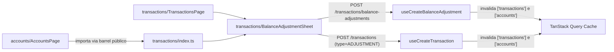

# Design — Reajuste de Saldo (Frontend)

## 1. Visão Arquitetural e Fronteiras entre Módulos

A lógica de domínio, mutação HTTP, validação Zod e UI do reajuste de saldo pertence ao módulo **`transactions`** (pois os endpoints são `POST /transactions/balance-adjustments` e `POST /transactions` com `type: 'ADJUSTMENT'`), enquanto o módulo **`accounts`** é o ponto de entrada contextual primário em `/accounts`.

Para respeitar `docs/architecture/module-boundaries.md` e reduzir a dívida `DT-03`:

- Criar **`src/features/transactions/index.ts`** como API pública enxuta do módulo `transactions`, exportando:
  - `BalanceAdjustmentSheet`
  - `type BalanceAdjustmentSheetState`
  - `type BalanceAdjustmentMode`
- `AccountsPage` consome `BalanceAdjustmentSheet` e `BalanceAdjustmentSheetState` **exclusivamente** via `@/features/transactions`.
- `src/shared/` permanece livre de imports de `src/features/*` (apenas aprimoramos `CurrencyInput` e `src/shared/errors/*`).



## 2. Rotas e Estado de URL

- **`/accounts` (`AccountsPage`):** sem novos parâmetros de URL obrigatórios; estado do sheet de reajuste mantido localmente em `AccountsPage` (`adjustmentSheetState: BalanceAdjustmentSheetState`).
- **`/transactions` (`TransactionsPage` + `transactionUrl.utils.ts`):**
  - Estender `TransactionView` para `'ALL' | 'EXPENSE' | 'INCOME' | 'TRANSFER' | 'ADJUSTMENT'`.
  - Suportar `?view=ADJUSTMENT` (limpando `categoryId` automaticamente, assim como `TRANSFER`).
  - Estender `TransactionCreateIntent` para incluir `'ADJUSTMENT'` (`?create=ADJUSTMENT` abre `BalanceAdjustmentSheet` no modo padrão `target`).

## 3. Contratos de API e TanStack Query

### 3.1 Endpoints (`src/features/transactions/constants/transaction.constants.ts`)

```ts
export const TRANSACTION_API_ENDPOINTS = {
  transactions: '/transactions',
  balanceAdjustments: '/transactions/balance-adjustments',
  // ...demais endpoints existentes
} as const
```

### 3.2 Tipos (`src/features/transactions/types/transaction.types.ts`)

```ts
export interface CreateBalanceAdjustmentDto {
  accountId: string
  targetBalanceCents: number
  date: string
  description?: string | null
}
```

- `targetBalanceCents`: inteiro seguro (`Number.MIN_SAFE_INTEGER` .. `Number.MAX_SAFE_INTEGER`), aceitando negativo, `0` e positivo.
- `date`: `DateOnly` (`YYYY-MM-DD`).
- `description`: opcional; omitida ou `null` quando vazia após `trim()`.
- Response `201 Created`: `Transaction` (`type: 'ADJUSTMENT'`, `status: 'EFFECTIVE'`, `direction: 'INCREASE' | 'DECREASE'`, `amountCents > 0`).

### 3.3 Mutations (`src/features/transactions/api/mutations.ts`)

- **Novo hook `useCreateBalanceAdjustment()`:**
  - `mutationFn`: `api.post<Transaction>(TRANSACTION_API_ENDPOINTS.balanceAdjustments, dto)` → retorna `data`.
  - `onSuccess`: chama `invalidateTransactionData()` (que invalida `TRANSACTION_QUERY_KEYS.transactions` e `ACCOUNT_QUERY_KEYS.accounts`, ambos com `exact: false`) e exibe toast:
    - `title`: `'Saldo reajustado'`
    - `description`: `'O ajuste foi registrado e o saldo da conta foi atualizado.'`
  - **Não** dispara `showApiErrorToast` em `onError` (evita duplicação com `ApiErrorAlert` inline no sheet).
- **Ajuste no toast de `useCreateTransaction()`:**
  - Quando `transaction.type === 'ADJUSTMENT'`:
    - `title`: `'Ajuste registrado'`
    - `description`: `'O lançamento de ajuste foi salvo com sucesso.'`

## 4. Tratamento Tipado de Erros (`src/shared/errors/`)

### 4.1 Novo código em `src/shared/errors/apiErrorCodes.ts`

```ts
balanceAdjustmentNoDifference: 'BALANCE_ADJUSTMENT_NO_DIFFERENCE',
```

### 4.2 Novo contexto em `src/shared/errors/apiError.types.ts`

Adicionar `'transactions.balance-adjustment'` em `ApiErrorContext`.

### 4.3 Inventário completo de erros e mapeamento em `src/shared/errors/resolveApiError.ts`

| `code` | Status | Superfície | Título | Descrição | `recovery` | Ação extra no Sheet |
| --- | ---: | --- | --- | --- | --- | --- |
| `BALANCE_ADJUSTMENT_NO_DIFFERENCE` | `409` | `ApiErrorAlert` inline | `O saldo já está atualizado` | `O saldo atual da conta já corresponde ao valor informado. Confira o saldo atualizado ou informe outro valor.` | `correct-fields` | Invalida `ACCOUNT_QUERY_KEYS.accounts` para sincronizar o saldo exibido |
| `VALIDATION_ERROR` | `400` | Erros de campo (`applyApiFieldErrors`) + `ApiErrorAlert` | `Confira os dados informados` | `Corrija os campos destacados para continuar.` | `correct-fields` | Foca primeiro campo inválido (`accountId`, `targetBalanceCents`, `date`, `description`) |
| `INVALID_TRANSACTION` | `400` | `ApiErrorAlert` inline | `Revise os dados da transação` | `Alguma informação não combina com as regras financeiras. Corrija os campos e tente novamente.` | `correct-fields` | Preserva valores |
| `TRANSACTION_ACCOUNT_UNAVAILABLE` | `409` | `ApiErrorAlert` inline | `Conta indisponível` | `Escolha uma conta ativa para continuar.` | `correct-fields` | Preserva valores |
| `TRANSACTION_CATEGORY_UNAVAILABLE` | `400`/`409` | `ApiErrorAlert` inline | *(context override em `transactions.balance-adjustment` ou copy existente)* | Para contexto `transactions.balance-adjustment`: `'Não foi possível registrar o reajuste'` / `'A configuração técnica de ajuste não está disponível para sua conta no momento.'` | `retry` | Preserva valores |
| Fallback de contexto (`transactions.balance-adjustment`) | outro | `ApiErrorAlert` inline | `Não foi possível aplicar o reajuste` | `Seus dados continuam nesta tela. Revise as informações e tente novamente.` | `retry` | Preserva valores |
| Rede / `500` / `401` | — | `ApiErrorAlert` / sessão | Padrão existente de `resolveApiError` | Padrão existente | `retry` / `sign-in` | Preserva valores |

> Nota sobre `TRANSACTION_CATEGORY_UNAVAILABLE`: em `resolveCopy`, quando `context === 'transactions.balance-adjustment'` e `code === API_ERROR_CODES.transactionCategoryUnavailable`, usar copy contextualizada (pois o usuário não escolhe categoria no reajuste, portanto dizer "Escolha uma categoria ativa" seria incorreto!).

## 5. `CurrencyInput` com Suporte Opcional a Negativos (`src/shared/components/atoms/CurrencyInput.tsx`)

Para suportar `targetBalanceCents` negativo, zero ou positivo mantendo 100% de compatibilidade com todos os formulários existentes:

- Nova prop opcional: `allowNegative?: boolean` (default `false`).
- Comportamento quando `allowNegative === false`: **inalterado** (todos os testes existentes continuam passando).
- Comportamento quando `allowNegative === true`:
  - `displayValue`: usa `formatCurrencyFromCents(valueCents)` (que já formata `-12345` como `-R$ 123,45` e `0` como `R$ 0,00`). Se houver estado pendente de sinal negativo antes do primeiro dígito (usuário digitou `-` em campo vazio), exibe `'-'` ou aplica o sinal negativo assim que o primeiro dígito > 0 for inserido.
  - Tecla `-`: se `valueCents` for `> 0`, emite `-valueCents`; se `valueCents` for `undefined` ou `0`, ativa flag interna `pendingNegative = true`.
  - Tecla `+`: desativa `pendingNegative`; se `valueCents < 0`, emite `Math.abs(valueCents)`.
  - Dígito `0-9`: calcula magnitude sobre `Math.abs(currentValue) * 10 + Number(key)` preservando o sinal (`isNegative ? -magnitude : magnitude`), evitando `-0` (zero é sempre `0`). Valida `Number.isSafeInteger(nextValue)`.
  - `Backspace`/`Delete`: reduz `Math.floor(Math.abs(valueCents) / 10)` preservando o sinal enquanto `> 0`; quando `Math.abs(valueCents) <= 9`, limpa para `undefined` e limpa `pendingNegative`.
  - `Paste`: detecta sinal `-` líder (ex.: `"-150,00"`, `"-R$ 150,00"`) e aplica ao inteiro em centavos se `allowNegative === true`.
- Em complemento ao teclado, o `BalanceAdjustmentSheet` acopla um **único botão inline compacto `+/−`** integrado na extremidade direita dentro do próprio campo `Novo saldo` (sem botões separados acima do input, seguindo o padrão de ação inline do Danfy), que alterna instantaneamente o sinal do valor e devolve o foco ao campo — garantindo ergonomia em teclados numéricos móveis (`inputMode="numeric"`) sem poluição visual. Quando o sinal negativo está ativo, o valor exibe destaque semântico `text-state-expense` (e `placeholder="-R$ 0,00"` se vazio).

## 6. Composição de Componentes (Atomic Design)

### 6.1 `src/shared/`
- **`atoms/CurrencyInput.tsx`** (atualizado): adiciona `allowNegative?: boolean`.
- **`errors/apiErrorCodes.ts`**, **`apiError.types.ts`**, **`resolveApiError.ts`** (atualizados): registra `BALANCE_ADJUSTMENT_NO_DIFFERENCE` e contexto `transactions.balance-adjustment`.

### 6.2 `src/features/transactions/`
- **Schemas (`schemas/balanceAdjustment.schema.ts`):**
  - `targetBalanceAdjustmentSchema`:
    - `accountId`: string não vazia (`'Escolha uma conta.'`)
    - `targetBalanceCents`: inteiro seguro (`Number.MIN_SAFE_INTEGER` .. `Number.MAX_SAFE_INTEGER`, obrigatório — `undefined` exibe `'Informe o novo saldo.'`)
    - `description`: string opcional/nullable, máximo `500` caracteres (`'Use até 500 caracteres.'`)
    - *(sem campo `date` editável pelo usuário na UI — o builder injeta automaticamente `getTodayDateOnly()` no momento do envio)*
  - `manualBalanceAdjustmentSchema`:
    - `accountId`: string não vazia (`'Escolha uma conta.'`)
    - `direction`: `'INCREASE' | 'DECREASE'` obrigatório (`'Escolha se o ajuste aumenta ou reduz o saldo.'`)
    - `amountCents`: inteiro positivo `> 0` e `<= Number.MAX_SAFE_INTEGER` (`'Informe um valor maior que zero.'`)
    - `status`: `'EFFECTIVE' | 'PENDING'` (padrão `'EFFECTIVE'`)
    - `description`: string obrigatória não vazia após `trim()`, máximo `500` caracteres (`'Informe o motivo do ajuste.'`)
    - *(sem campo `date` editável pelo usuário na UI — o builder injeta automaticamente `getTodayDateOnly()` no momento do envio)*
  - Em `schemas/transaction.schema.ts`:
    - Atualizar limite de `description` para `500` caracteres (alinhado ao backend `TRANSACTION_DESCRIPTION_MAX_LENGTH = 500`).
    - Adicionar em `superRefine`: quando `values.type === 'ADJUSTMENT'` e `!values.description?.trim()`, adicionar issue em `['description']`: `'Informe o motivo do ajuste.'`.
- **Utils (`utils/balanceAdjustment.utils.ts`):**
  - `computeTargetBalanceDelta(currentCents: number, targetBalanceCents: number)`: retorna `{ kind: 'no-change' } | { kind: 'overflow' } | { kind: 'increase' | 'decrease'; amountCents: number }` usando `BigInt`.
  - `computeManualResultingBalance(currentCents: number, amountCents: number, direction: TransactionDirection)`: retorna `{ ok: true; resultingCents: number } | { ok: false }` usando `BigInt`.
  - `buildCreateBalanceAdjustmentDto(values: TargetBalanceAdjustmentValues): CreateBalanceAdjustmentDto`.
  - `buildManualAdjustmentTransactionDto(values: ManualBalanceAdjustmentValues): CreateTransactionDto`.
- **Molecule (`components/molecules/BalanceAdjustmentPreview.tsx`):**
  - Componente puramente apresentacional (sem API/store) exibindo a prévia de impacto no saldo:
    - Variante `target`: mostra direção (`Acréscimo` / `Redução` / `Sem diferença` / `Limite excedido`), ícone (`TrendingUp` / `TrendingDown` / `Info` / `AlertCircle`), valor em `.numeric`, e texto explicativo claro.
    - Variante `manual`: mostra `Saldo atual` → `Saldo após o ajuste` (ou `Saldo previsto após efetivação` quando `PENDING`), com `.numeric`.
- **Organism (`components/organisms/BalanceAdjustmentSheet.tsx`):**
  - Props:
    ```ts
    export type BalanceAdjustmentMode = 'target' | 'manual'

    export type BalanceAdjustmentSheetState =
      | {
          account?: Account
          initialAccountId?: string | null
          initialMode?: BalanceAdjustmentMode
        }
      | null
    ```
    - `state: BalanceAdjustmentSheetState`
    - `accounts: Account[]` (lista de contas disponíveis; filtra `!account.isArchived`)
    - `onOpenChange: (isOpen: boolean) => void`
  - Superfície responsiva Material 3 / Danfy Dark:
    - Mobile (`useIsMobile()`): `Sheet` com `side="bottom"`, `rounded-t-3xl`, `max-h-[calc(100dvh-1rem)]`, `pb-[max(env(safe-area-inset-bottom),1rem)]`.
    - Desktop: `Sheet` com `side="right"`, `sm:max-w-lg`, layout em coluna com corpo rolável e `SheetFooter` fixo.
  - Cabeçalho:
    - Título: `'Reajustar saldo'`
    - Descrição: `'Corrija o saldo da conta registrando um lançamento técnico de ajuste.'`
  - Bloco de conta:
    - Se `state.account` foi fornecido (vindo de `/accounts`): card compacto com `AccountIdentity`, nome da conta e **Saldo atual** (`.numeric`), sempre sincronizado com a lista mais recente em `accounts` (`accounts.find(a => a.id === state.account.id) ?? state.account`) para refletir atualizações em tempo real (inclusive após `409 BALANCE_ADJUSTMENT_NO_DIFFERENCE`).
    - Caso contrário (vindo de `/transactions`): `<Select>` de contas ativas exibindo `AccountIdentity`, nome e saldo atual; se não houver contas ativas, alerta informativo.
  - Seletor de modo (segmented tabs `role="tablist"` / `role="tab"`):
    - Tab 1 (default): **`Informar novo saldo`**
    - Tab 2: **`Informar valor do ajuste`**
    - Ao alternar modo: reseta erros de mutação, preserva `accountId`, `date` e `description`.
  - Formulário do modo `target`:
    - Controle de sinal (`Positivo (+)` / `Negativo (−)`) + `CurrencyInput` (`allowNegative`, `aria-label="Novo saldo"`).
    - `BalanceAdjustmentPreview` ao vivo.
    - Nota discreta quando `selectedAccount.balance.projectedCents !== selectedAccount.balance.currentCents`: `"Baseado no saldo atual efetivado. Lançamentos pendentes não são alterados."`.
    - Campo `Data` (presets `Hoje`, `Ontem` + `DateOnlyPicker`).
    - Campo `Motivo (opcional)` (`Input` max 500 chars + helper `"Se ficar em branco, será salvo como \"Reajuste de saldo\"."`).
    - `ApiErrorAlert` inline quando houver erro.
    - Footer: `Cancelar` (`variant="outline"`) + `Aplicar reajuste` (`bg-brand text-brand-foreground`).
  - Formulário do modo `manual`:
    - Seletor visual de `Direção` (2 botões em grid 2 colunas): `Aumentar saldo (+)` (`TrendingUp`, borda/fundo `state-income` quando ativo) e `Reduzir saldo (−)` (`TrendingDown`, borda/fundo `state-expense` quando ativo).
    - `CurrencyInput` (`allowNegative={false}`, `aria-label="Valor do ajuste"`).
    - `BalanceAdjustmentPreview` ao vivo mostrando saldo resultante.
    - Switch `Situação` (`Efetivar agora` / `Pendente`), mesmo padrão de `TransactionFormSheet`.
    - Campo `Data` (`Hoje`, `Ontem`, `DateOnlyPicker`).
    - Campo `Motivo` (obrigatório, max 500 chars).
    - `ApiErrorAlert` inline quando houver erro.
    - Footer: `Cancelar` + `Registrar ajuste`.
- **Atualizações em `transactions` existentes:**
  - `constants/transaction.constants.ts`:
    - `TRANSACTION_API_ENDPOINTS.balanceAdjustments = '/transactions/balance-adjustments'`.
    - `TRANSACTION_TYPE_ICONS.ADJUSTMENT = SlidersHorizontal`.
    - Adicionar `{ value: 'ADJUSTMENT', label: 'Ajustes', icon: SlidersHorizontal, tone: 'info' }` em `TRANSACTION_VIEW_OPTIONS`.
    - Adicionar `ADJUSTMENT: 'Novo ajuste'` em `TRANSACTION_VIEW_CREATE_LABELS`.
  - `types/transaction-ui.types.ts`:
    - `TransactionView = 'ALL' | 'EXPENSE' | 'INCOME' | 'TRANSFER' | 'ADJUSTMENT'`.
  - `utils/transactionUrl.utils.ts`:
    - Incluir `'ADJUSTMENT'` em `TRANSACTION_VIEW_VALUES` e `TransactionCreateIntent`.
    - Limpar `categoryId` quando `view === 'TRANSFER' || view === 'ADJUSTMENT'`.
  - `utils/transaction.utils.ts`:
    - Atualizar `getTransactionAmountSign`, `getTransactionAmountClassName` e `formatSignedTransactionAmount` para aceitar `direction` (mantendo assinatura retrocompatível com `direction?: TransactionDirection | null`):
      - `ADJUSTMENT` + `INCREASE` → sinal `'+'`, classe `'text-state-income'`;
      - `ADJUSTMENT` + `DECREASE` → sinal `'−'`, classe `'text-state-expense'`;
    - Adicionar helper `getTransactionDirectionLabel(direction: TransactionDirection | null)`: `'INCREASE' -> 'Acréscimo'`, `'DECREASE' -> 'Redução'`.
    - Atualizar `getCategoryName`: para `ADJUSTMENT`, retornar `'Ajuste (Acréscimo)'` / `'Ajuste (Redução)'` (ou manter `'Ajuste'` na coluna e exibir direção claramente junto, ex.: `'Ajuste · Acréscimo'` / `'Ajuste · Redução'`).
  - `components/organisms/TransactionsKpiGrid.tsx`:
    - Em `getTypeSummaryLabels(view)`, tratar `view === 'ADJUSTMENT'` com `{ pending: 'Ajustes pendentes', effective: 'Ajustes efetivados', total: 'Total ajustado', tone: 'info', Icon: SlidersHorizontal }`.
  - `components/organisms/TransactionFiltersSheet.tsx`:
    - Quando `view === 'ADJUSTMENT'`, ocultar filtro de categoria e exibir aviso de categoria técnica.
  - `components/organisms/TransactionDetailsSheet.tsx`:
    - Quando `transaction.type === 'ADJUSTMENT'`, renderizar `<DetailItem label="Direção">` com ícone + `'Acréscimo no saldo'` / `'Redução no saldo'`, e renderizar ícone `SlidersHorizontal` em `TransactionCategoryDetail`.
  - `components/organisms/TransactionFormSheet.tsx`:
    - Quando `isEditing` e `selectedType === 'ADJUSTMENT'`:
      - Incluir `'ADJUSTMENT'` no select de tipo (ou mostrar `'Ajuste'` corretamente sem valor órfão);
      - Exibir seletor de `Direção` (`Acréscimo` / `Redução`);
      - Exigir descrição obrigatória;
      - Ocultar categoria e comprovantes.
  - `components/pages/TransactionsPage.tsx`:
    - Adicionar estado `balanceAdjustmentSheetState: BalanceAdjustmentSheetState`.
    - Quando `createIntent === 'ADJUSTMENT'` ou `TransactionCreateButton` for clicado com `view === 'ADJUSTMENT'`, abrir `BalanceAdjustmentSheet` com `{ initialAccountId: filters.accountId }`.
    - Passar `categoryId: view === 'TRANSFER' || view === 'ADJUSTMENT' ? undefined : ...` em `listParams`.
    - Renderizar `<BalanceAdjustmentSheet state={balanceAdjustmentSheetState} accounts={accounts} onOpenChange={...} />`.

### 6.3 `src/features/accounts/`
- **`components/organisms/AccountCard.tsx`:**
  - Adicionar prop `onAdjustBalance: () => void`.
  - Em `AccountDetailsPanel`:
    - Quando `!account.isArchived`: habilitar botão `Reajustar saldo` (`variant="outline"`, borda/texto semânticos ativos `border-border bg-secondary text-foreground hover:bg-accent`) fechando `isDetailsOpen` e chamando `onAdjustBalance()`.
    - Quando `account.isArchived`: manter botão desabilitado + texto auxiliar discreto `"Restaure a conta para reajustar o saldo."`.
  - Em `AccountActionsMenu`:
    - Exibir `Reajustar saldo` (sem badge `"Planejado"`) apenas quando `!isArchived`, desabilitado quando `isMutating`, disparando `onAdjustBalance`.
- **`components/pages/AccountsPage.tsx`:**
  - Adicionar estado `adjustmentSheetState: BalanceAdjustmentSheetState`.
  - Passar `onAdjustBalance={() => setAdjustmentSheetState({ account })}` para `AccountCard`.
  - Renderizar `<BalanceAdjustmentSheet state={adjustmentSheetState} accounts={accounts} onOpenChange={...} />` importado de `@/features/transactions`.

## 7. Decisões de Design System (Danfy Dark + Material 3)

- **Superfície:** `Sheet` (não `Dialog`) porque o reajuste é uma criação/edição contextual anexada à tela atual (`/accounts` ou `/transactions`), conforme regra de interação do `danfy-finance-design-system`.
- **Tokens:** apenas `bg-app-surface`, `bg-card`, `bg-secondary`, `border-border`, `text-foreground`, `text-muted-foreground`, `bg-brand`/`bg-primary`, `text-state-income`, `text-state-expense`, `text-state-info`, `text-state-warning`, `text-destructive`. Zero hex/rgb/paleta bruta.
- **Hierarquia visual:** saldo atual em destaque `.numeric` no topo → seletor de modo → campo principal (`Novo saldo` ou `Valor do ajuste`) → cartão de prévia em tempo real → data e motivo → footer com ação primária clara.
- **Não depender apenas de cor:** direção sempre acompanhada de sinal (`+` / `−`), ícone (`TrendingUp` / `TrendingDown`) e texto (`Acréscimo` / `Redução`).

## 8. Estratégia de Testes (Vitest + Testing Library)

1. **`CurrencyInput.test.tsx`**: cobrir `allowNegative` (digitação de `-` e `+`, dígitos após sinal, backspace até limpar, zero `0` nunca virando `-0`, paste negativo `"-123,45"`, e regressão de que `allowNegative={false}` continua ignorando `-`).
2. **`resolveApiError.test.ts`**: cobrir `BALANCE_ADJUSTMENT_NO_DIFFERENCE` (`409`), contexto `'transactions.balance-adjustment'` com `TRANSACTION_CATEGORY_UNAVAILABLE`, `TRANSACTION_ACCOUNT_UNAVAILABLE`, `VALIDATION_ERROR`, `INVALID_TRANSACTION`, erro de rede e `500`.
3. **`balanceAdjustment.utils.test.ts` / `balanceAdjustment.schema.test.ts`**: cobrir `BigInt` delta para positivo→positivo menor, positivo→positivo maior, positivo→zero, positivo→negativo, negativo→positivo, `delta === 0`, overflow acima de `MAX_SAFE_INTEGER`, normalização de descrição opcional (modo target) e obrigatoriedade de descrição (modo manual).
4. **`BalanceAdjustmentSheet.test.tsx`**:
   - Fluxo principal `target`: conta em `100000`, usuário digita `50000`, verifica prévia `- R$ 500,00`, envia `POST /transactions/balance-adjustments` com payload exato e fecha sheet.
   - Fluxo `target` negativo e zero (`0`, `-25000`).
   - Bloqueio quando `targetBalanceCents === currentCents` e tratamento de `409 BALANCE_ADJUSTMENT_NO_DIFFERENCE` mantendo dados e exibindo `ApiErrorAlert`.
   - Fluxo `manual`: alterna aba, seleciona direção, informa valor e motivo, valida motivo obrigatório, envia `POST /transactions` com `type: 'ADJUSTMENT'` sem `categoryId`.
   - Erros de campo (`VALIDATION_ERROR` com `details.fields`) e erro de rede preservando valores digitados.
5. **`AccountCard.test.tsx`**: verificar que `Reajustar saldo` está habilitado para conta ativa (no menu e no detalhe), aciona `onAdjustBalance`, e fica bloqueado/oculto para conta arquivada.
6. **`TransactionsTable.test.tsx` / `TransactionDetailsSheet.test.tsx` / `TransactionsKpiGrid.test.tsx` / `TransactionFormSheet.test.tsx`**: cobrir exibição de `ADJUSTMENT` (`INCREASE`/`DECREASE`), KPIs da visão `ADJUSTMENT` e edição de `ADJUSTMENT`.

## 9. Impacto Documental

Na mesma entrega, sincronizar via skill `modular-documentation`:
- `docs/transactions/flows/balance-adjustment.md` (novo documento de fluxo implementado)
- `docs/transactions/README.md`, `docs/transactions/concepts/transaction-model-and-types.md`, `docs/transactions/reference/api-and-contracts.md`
- `src/features/transactions/AGENTS.md`
- `docs/accounts/README.md`, `docs/accounts/flows/account-detail-and-summary.md`, `docs/accounts/reference/api-and-contracts.md`
- `src/features/accounts/AGENTS.md`
- `docs/architecture/module-boundaries.md` (atualizar `DT-03` registrando `src/features/transactions/index.ts`)
