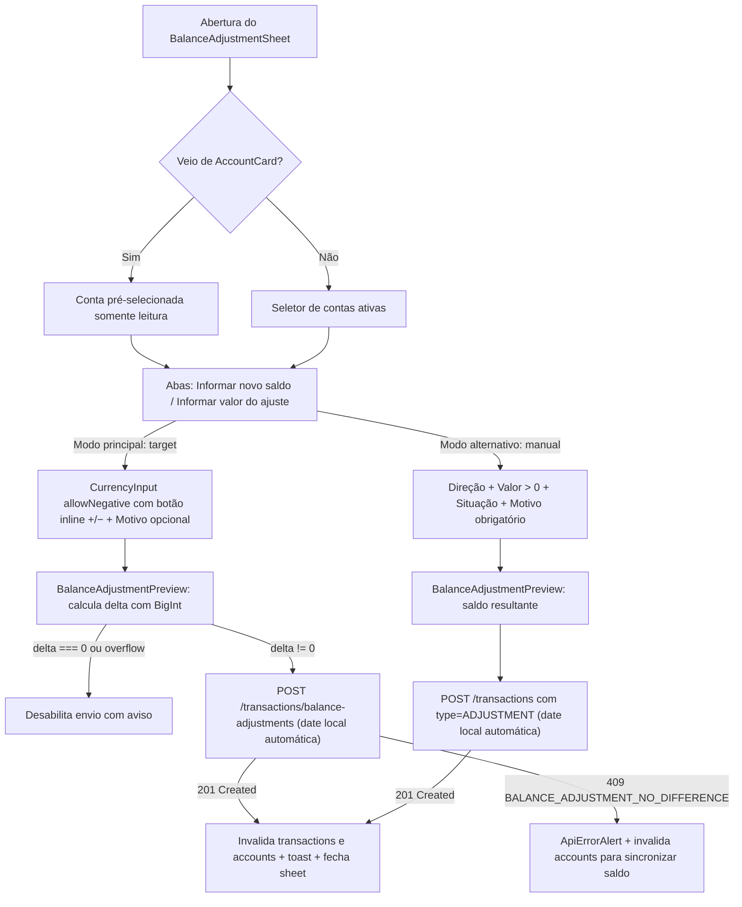

# Reajuste de Saldo (Saldo Alvo e Ajuste Manual)

Permite corrigir o saldo atual de uma conta ativa registrando um lançamento técnico do tipo `ADJUSTMENT`, tanto informando o saldo real desejado (`target`) quanto informando diretamente valor e direção (`manual`).

## Atores, Pré-condições e Pontos de Entrada

- **Ator:** usuário autenticado.
- **Pré-condições:** pelo menos uma conta ativa (`isArchived === false`). Contas arquivadas não podem ser reajustadas.
- **Rotas frontend:** `/accounts` e `/transactions` (`?view=ADJUSTMENT` e `?create=ADJUSTMENT`).
- **Pontos de entrada:**
  - Em `/accounts`: item `Reajustar saldo` no `AccountActionsMenu` ou botão `Reajustar saldo` dentro do `AccountDetailsPanel` (fecha o painel de detalhes antes de abrir o sheet para evitar conflito de foco).
  - Em `/transactions`: `TransactionCreateButton` (`Novo ajuste`) na visão `ADJUSTMENT` ou deep link `/transactions?create=ADJUSTMENT` (pré-seleciona `filters.accountId` se houver filtro de conta ativo).

## Fluxo Principal e Alternativos

1. **Modo Principal — Informar novo saldo (`target`):**
   - Abre selecionado por padrão.
   - Exibe o **Saldo atual** (efetivado) da conta.
   - Aceita `targetBalanceCents` negativo, zero (`0`) ou positivo em um único campo `CurrencyInput` (`allowNegative`) com botão inline compacto `+/−` integrado à extremidade direita (devolvendo foco ao input ao alternar), além de suporte às teclas `-` e `+`.
   - Calcula `delta = BigInt(targetBalanceCents) - BigInt(currentCents)` em tempo real no `BalanceAdjustmentPreview`. Bloqueia envio se `delta === 0` ou `|delta| > Number.MAX_SAFE_INTEGER`.
   - Não exibe seletor de data na UI; envia `POST /transactions/balance-adjustments` preenchendo automaticamente `date` com a data civil local atual (`getTodayDateOnly()`, formato `YYYY-MM-DD`) junto de `{ accountId, targetBalanceCents, description }`, normalizando descrição em branco para `null`.
2. **Modo Alternativo — Informar valor do ajuste (`manual`):**
   - Ao alternar entre abas, preserva apenas `accountId` e `description`, limpando erros anteriores de mutação.
   - Exige `direction` (`INCREASE` / `DECREASE`), `amountCents > 0`, `status` (`EFFECTIVE` por padrão ou `PENDING`) e `description` obrigatória (1 a 500 caracteres).
   - Não exibe seletor de data na UI; envia `POST /transactions` com `{ accountId, type: 'ADJUSTMENT', status, amountCents, direction, date, description }`, preenchendo automaticamente `date` com a data civil local atual (`getTodayDateOnly()`, formato `YYYY-MM-DD`), sem `categoryId` nem `destinationAccountId`.
3. **Consulta, Edição, Confirmação e Exclusão em `/transactions?view=ADJUSTMENT`:**
   - Lista transações `ADJUSTMENT` sem `categoryId`, exibe KPIs dedicados (`Ajustes pendentes`, `Ajustes efetivados`, `Total ajustado`), mostra sinal `+`/`−`, cor semântica (`state-income`/`state-expense`) e rótulo `Acréscimo`/`Redução`.
   - `TransactionDetailsSheet` exibe o campo `Direção`, oculta comprovantes e permite `Editar`, `Excluir` e `Confirmar ajuste` (se `PENDING`).
   - `TransactionFormSheet` permite editar valor, direção, data, conta e motivo obrigatório (até 500 caracteres) via `PATCH /transactions/:id` diff-only.

## Estados de Interface e Recuperação

| Estado | Comportamento observado | Recuperação / Próximo passo |
| --- | --- | --- |
| Sem contas ativas | Alerta informativo no topo do sheet e botão de envio desabilitado | Criar ou restaurar uma conta em `/accounts` |
| Sem diferença (`delta === 0`) | Card de prévia (`state-warning`) avisa que o saldo já é igual; botão desabilitado | Informar outro valor |
| Pending | Botão primário desabilitado (`Aplicando reajuste...` / `Registrando ajuste...`) preservando campos | Aguarda conclusão |
| Success | Fecha sheet, exibe toast (`Saldo reajustado` ou `Ajuste registrado`) e invalida `['transactions']` e `['accounts']` | Saldos e listas atualizados |
| Erro (`409`, `400`, rede, `500`) | Sheet permanece aberto preservando dados; `applyApiFieldErrors` + `ApiErrorAlert` no contexto `transactions.balance-adjustment`; no `409 BALANCE_ADJUSTMENT_NO_DIFFERENCE`, invalida `['accounts']` | Corrigir campo, revisar saldo atualizado ou tentar novamente |

## Segurança e Privacidade

- Nunca envia `userId` no payload; a sessão utiliza cookie `HttpOnly`.
- Datas civis (`date`) seguem estritamente `DateOnly` (`YYYY-MM-DD`) sem `toISOString()`.
- Valores monetários são sempre inteiros seguros em centavos; cálculos de prévia usam `BigInt` para prevenir overflow.
- Mensagens de erro nunca expõem `message` bruto ou códigos internos do backend.

## Consumo de Backend

| Operação | Autenticação | Contrato relevante | Efeito / Cache | Erros e recuperação | Fonte |
| --- | --- | --- | --- | --- | --- |
| `POST /transactions/balance-adjustments` | Cookie HttpOnly | `{ accountId, targetBalanceCents, date, description? }` | Invalida `['transactions']` e `['accounts']` (`exact: false`) | `BALANCE_ADJUSTMENT_NO_DIFFERENCE`, `VALIDATION_ERROR`, `INVALID_TRANSACTION`, `TRANSACTION_ACCOUNT_UNAVAILABLE`, `TRANSACTION_CATEGORY_UNAVAILABLE` | `personal-finance-backend:docs/integrations/transactions/create-balance-adjustment.md` |
| `POST /transactions` | Cookie HttpOnly | `type: 'ADJUSTMENT'`, `direction`, `amountCents > 0`, `status`, `date`, `description` | Invalida `['transactions']` e `['accounts']` (`exact: false`) | `VALIDATION_ERROR`, `INVALID_TRANSACTION`, `TRANSACTION_ACCOUNT_UNAVAILABLE`, `TRANSACTION_CATEGORY_UNAVAILABLE` | `personal-finance-backend:docs/integrations/transactions/create-transaction.md` |
| `GET /transactions` | Cookie HttpOnly | `type=ADJUSTMENT`, sem `categoryId` | `['transactions', 'list', params]` | `ApiErrorAlert` (`transactions.list`) com retry | `personal-finance-backend:docs/integrations/transactions/list-transactions.md` |
| `PATCH /transactions/:id` | Cookie HttpOnly | Diff-only incluindo `direction` e `description` obrigatória | Invalida `['transactions']` e `['accounts']` (`exact: false`) | `applyApiFieldErrors` + `ApiErrorAlert` (`transactions.update`) | `personal-finance-backend:docs/integrations/transactions/update-transaction.md` |
| `PATCH /transactions/:id/confirm` | Cookie HttpOnly | Efetiva ajuste `PENDING` | Invalida `['transactions']` e `['accounts']` (`exact: false`) | `ApiErrorAlert` (`transactions.confirm`) | `personal-finance-backend:docs/integrations/transactions/confirm-transaction.md` |
| `DELETE /transactions/:id` | Cookie HttpOnly | Exclui ajuste | Invalida `['transactions']` e `['accounts']` (`exact: false`) | `ApiErrorAlert` (`transactions.delete`) | `personal-finance-backend:docs/integrations/transactions/delete-transaction.md` |
